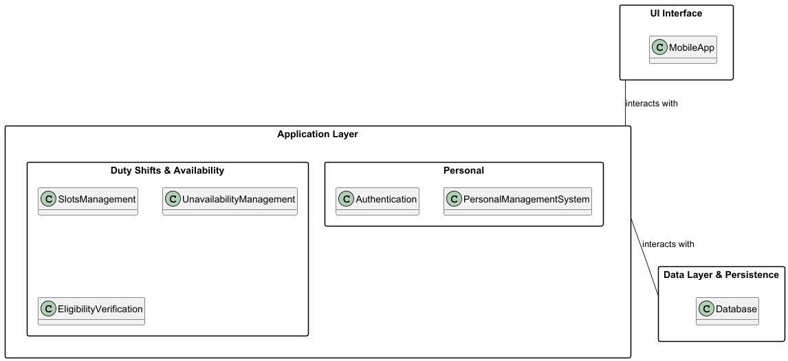

# Escala

**Escala is a shared shift schedule for fire stations that mix professional firefighters, volunteers and cadets: it always shows who is on shift and lets members manage their availability, swaps and shift extensions themselves.**

Escala is the product of LABDSOF 2026/27 (MSc in Computer Engineering, ISEP).

> **Status.** Sprint 1 (22 September to 1 November 2026): discovery, design and walking skeleton. The repository holds documentation only; there is no application code to run yet.

## The problem

The station's weekly schedule is built in Excel, printed and posted at the station, and some members share a photo of it in a WhatsApp group. Every change means editing and reprinting it.

- **Checking the schedule.** Members have to go to the station or wait for someone to post an update, so they often rely on an outdated schedule.
- **Keeping track of changes.** Shift extensions caused by emergencies and swaps between members are easily lost before they reach the supervisor.
- **Requesting swaps.** Volunteers and cadets fit their shifts around jobs, school and personal lives, and have no easy way to arrange a swap and know whether it was accepted.

## What Escala does

| User group | Main features |
|---|---|
| Professional firefighters, volunteers and cadets | Define their unavailability in advance; check their schedule on the phone and get notified of every change that affects them; request shift swaps among themselves |
| Professional firefighters | Register shift extensions and off-hours call-outs after the emergency, for the supervisor to approve |
| Supervisor | Build the weekly schedule with each member's availability, minimum hours and weekly limit in view; automatic checks for unavailability, unfilled roles, overlapping shifts and hours above the limit; publish changes without reprinting; see every change in the change log |
| Station chief | See who is on shift and who is available, to plan training sessions |
| Dispatchers | On-shift board showing who is on shift at any moment |

Escala complements the station's existing dispatch app and does not integrate with it: it shows who is on shift, never who was dispatched.

The user journeys, personas and the rest of the product documentation are in the team's Confluence space (see [Documentation](#documentation)).

## Architecture

This is the planned architecture; only the empty skeletons of the components exist so far.



| Component                   | Technology               | Responsibility                                                                   |
|-----------------------------|--------------------------|----------------------------------------------------------------------------------|
| `apps/web`                  | Angular PWA              | The client, on members' phones and on the station computers                      |
| `apps/escala-api`           | Spring Boot (Java)       | People, rosters, slots, unavailability, requests and audit                       |
| `apps/elegibilidade-worker` | Spring Boot (Java)       | Evaluations, extractions and observed risk; talks to IPMA and the language model |
| RabbitMQ                    | Message broker           | Asynchronous events between the two services                                     |
| PostgreSQL                  | One database per service | No service reads another service's database                                      |

The two backend services are deployed independently. The full design is in [docs/architecture/technical-design.md](docs/architecture/technical-design.md) and the decisions behind it are in [docs/adr/](docs/adr/README.md).

## Repository layout

One monorepo, one folder per deployable component. The top-level folders exist from the start; `contracts/`, `tools/` and `infra/` are still empty, and each sub-folder marked *(planned)* is created by the first pull request that needs it.

```
.
├── apps/
│   ├── escala-api/             Spring Boot 4 (Java 21, Maven), port 8080   (skeleton)
│   ├── elegibilidade-worker/   Spring Boot 4 (Java 21, Maven), port 8081   (skeleton)
│   └── web/                    Angular 21 PWA, port 4200                   (skeleton)
├── contracts/                  openapi.yaml and events/                    (empty)
├── tools/
│   └── ipma-sim/               IPMA simulator container                    (planned)
├── infra/                      Docker Compose, Prometheus, Grafana         (empty)
├── docs/                       ADRs, technical design, test strategy, operations, reports
├── .github/                    CODEOWNERS, pull request template, workflows
└── README.md
```

## How to run

There is nothing to run yet. The walking skeleton is tracked in Jira (SCRUM-44, SCRUM-45, SCRUM-47).

The goal is one command, from a clean clone, that starts the whole stack with Docker Compose:

```bash
git clone https://github.com/DiogoC0307/LABDSOF_2627_1221137_1211439_1211514_1250505.git
cd LABDSOF_2627_1221137_1211439_1211514_1250505
# [TODO: the one command, once infra/ exists]
```

Planned prerequisites: Git and Docker with Docker Compose v2. Environments, configuration, deployment and rollback are described in [docs/operations/deployment-and-operations.md](docs/operations/deployment-and-operations.md).

## How to build and test

Prerequisites for development: JDK 21 and Node.js 22.12+ or 24+.

```bash
# Backend services (run in apps/escala-api or apps/elegibilidade-worker)
./mvnw verify            # build, tests and JaCoCo coverage report (target/site/jacoco)
./mvnw spring-boot:run   # escala-api on :8080, elegibilidade-worker on :8081 (health: /actuator/health)

# Frontend (run in apps/web)
npm ci
npm run build            # production build in dist/web
npm run test:ci          # unit tests (Vitest) with coverage in coverage/web
npm start                # dev server on :4200
```

The continuous integration pipeline is [.github/workflows/ci.yml](.github/workflows/build.yml): it builds, tests and analyses the three components with SonarQube on every pull request and push to `main`. Its stages are described in [.github/workflows/README.md](.github/workflows/README.md). Test types, tools and the test-case convention are in [docs/testing/test-strategy.md](docs/testing/test-strategy.md).

## Documentation

| Where                                                                                                       | What                                                                                       |
|-------------------------------------------------------------------------------------------------------------|--------------------------------------------------------------------------------------------|
| [docs/README.md](docs/README.md)                                                                            | How the documentation is organised                                                         |
| [docs/architecture/](docs/architecture/)                                                                    | Technical design, domain model and architecture diagrams (PlantUML sources and images)     |
| [docs/adr/](docs/adr/README.md)                                                                             | Architecture decision records and their index                                              |
| [docs/testing/test-strategy.md](docs/testing/test-strategy.md)                                              | Test strategy                                                                              |
| [docs/operations/deployment-and-operations.md](docs/operations/deployment-and-operations.md)                | Deployment and operations                                                                  |
| [docs/reports/](docs/reports/)                                                                              | Sprint reports                                                                             |
| [Confluence space](https://isep-team-apn94608.atlassian.net/wiki/spaces/L) (team access)                    | Problem, research, vision, personas, user journeys, requirements, backlog and sprint pages |
| [Jira project `SCRUM`](https://isep-team-apn94608.atlassian.net/jira/software/projects/SCRUM) (team access) | Backlog, sprints, decisions and feedback                                                   |

## How we work

- **`main` is protected.** It changes only through a pull request approved by another member; nobody approves their own pull request.
- **Branches** are short-lived and named `<type>/SCRUM-<n>-<short-description>`, for example `docs/SCRUM-10-readme`.
- **Commits** follow [Conventional Commits](https://www.conventionalcommits.org/) and carry the Jira key: `<type>(<scope>): <summary> (SCRUM-<n>)`.
- **Pull requests** are one per Jira issue and use the [pull request template](.github/pull_request_template.md).

The complete rules are on the Confluence page *Git, Pull Request and Jira Rules*.

## Team

| Name          | Student no. | GitHub                                                           | Role                     |
|---------------|-------------|------------------------------------------------------------------|--------------------------|
| Diogo Pereira | 1221137     | [@DiogoPereira-1221137](https://github.com/DiogoPereira-1221137) | Product Owner, Developer |
| Diogo Sousa   | 1250505     | [@diogojms2](https://github.com/diogojms2)                       | Scrum Master, Developer  |
| Pedro Costa   | 1211439     | [@PPedroC](https://github.com/PPedroC)                           | Developer                |
| Diogo Costa   | 1211514     | [@DiogoC0307](https://github.com/DiogoC0307)                     | Developer                |

## AI usage and third-party material

Parts of the documentation were drafted with AI assistance (Claude) and reviewed by a team member before being merged. The prompt used to generate the documentation templates is kept in [docs/claude-code-docs-templates-prompt.md](docs/claude-code-docs-templates-prompt.md), and each pull request states which parts were AI-assisted. The full record of AI tools and third-party material is on the Confluence page *AI Usage and Third-Party Attribution*.

The Product Vision Board and the persona sheets in the reports are based on templates by Roman Pichler (romanpichler.com), licensed under CC BY-SA 4.0.
