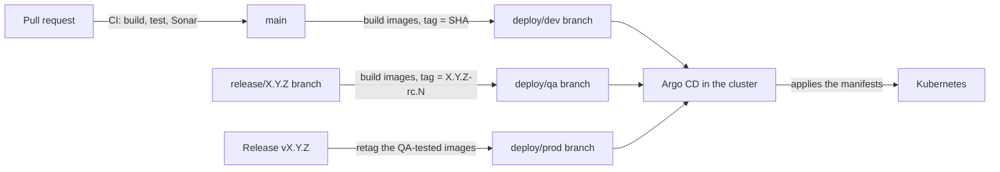
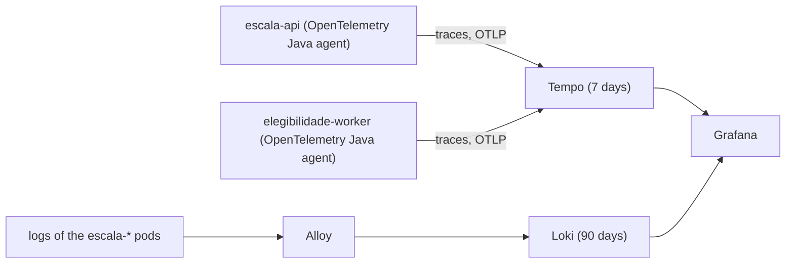

# Escala

**Escala is a shared shift schedule for fire stations that mix professional firefighters, volunteers and cadets: it always shows who is on shift and lets members manage their availability, swaps and shift extensions themselves.**

Escala is the product of LABDSOF 2026/27 (MSc in Computer Engineering, ISEP).

> **Status.** Sprint 1 (22 September to 1 November 2026): discovery, design and walking skeleton. The repository holds documentation only; there is no application code to run yet.

## The problem

The station's weekly schedule is built in Excel, printed and posted at the station, and some members share a photo of it in a WhatsApp group. Every change means editing and reprinting it.

- **Checking the schedule.** Members have to go to the station or wait for someone to post an update, so they often rely on an outdated schedule.
- **Keeping track of changes.** Shift extensions caused by emergencies and swaps between members are easily lost before they reach the supervisor.
- **Requesting swaps.** Volunteers and cadets fit their shifts around jobs, school and personal lives, and have no easy way to arrange a swap and know whether it was accepted.

## What Escala does

| User group | Main features |
|---|---|
| Professional firefighters, volunteers and cadets | Define their unavailability in advance; check their schedule on the phone and get notified of every change that affects them; request shift swaps among themselves |
| Professional firefighters | Register shift extensions and off-hours call-outs after the emergency, for the supervisor to approve |
| Supervisor | Build the weekly schedule with each member's availability, minimum hours and weekly limit in view; automatic checks for unavailability, unfilled roles, overlapping shifts and hours above the limit; publish changes without reprinting; see every change in the change log |
| Station chief | See who is on shift and who is available, to plan training sessions |
| Dispatchers | On-shift board showing who is on shift at any moment |

Escala complements the station's existing dispatch app and does not integrate with it: it shows who is on shift, never who was dispatched.

The user journeys, personas and the rest of the product documentation are in the team's Confluence space (see [Documentation](#documentation)).

## Architecture

This is the planned architecture; only the empty skeletons of the components exist so far.


| Component                   | Technology               | Responsibility                                                                   |
|-----------------------------|--------------------------|----------------------------------------------------------------------------------|
| `apps/web`                  | Angular PWA              | The client, on members' phones and on the station computers                      |
| `apps/escala-api`           | Spring Boot (Java)       | People, rosters, slots, unavailability, requests and audit                       |
| `apps/elegibilidade-worker` | Spring Boot (Java)       | Evaluations, extractions and observed risk; talks to IPMA and the language model |
| RabbitMQ                    | Message broker           | Asynchronous events between the two services                                     |
| PostgreSQL                  | One database per service | No service reads another service's database                                      |

The two backend services are deployed independently. The full design is in [docs/architecture/technical-design.md](docs/architecture/technical-design.md) and the decisions behind it are in [docs/adr/](docs/adr/README.md).

## Repository layout

One monorepo, one folder per deployable component. The top-level folders exist from the start; `contracts/`, `tools/` and `infra/` are still empty, and each sub-folder marked *(planned)* is created by the first pull request that needs it.

```
.
├── apps/
│   ├── escala-api/             Spring Boot 4 (Java 21, Maven), port 8080   (skeleton)
│   ├── elegibilidade-worker/   Spring Boot 4 (Java 21, Maven), port 8081   (skeleton)
│   └── web/                    Angular 21 PWA, port 4200                   (skeleton)
├── contracts/                  openapi.yaml and events/                    (empty)
├── tools/
│   └── ipma-sim/               IPMA simulator container                    (planned)
├── infra/                      Docker Compose, Prometheus, Grafana         (empty)
├── docs/                       ADRs, technical design, test strategy, operations, reports
├── .github/                    CODEOWNERS, pull request template, workflows
└── README.md
```

## How to run

Prerequisites: Git and Docker with Docker Compose v2. Nothing else: the images build with multi-stage Dockerfiles, so no JDK or Node.js is needed on your machine.

```bash
git clone https://github.com/DiogoC0307/LABDSOF_2627_1221137_1211439_1211514_1250505.git
cd LABDSOF_2627_1221137_1211439_1211514_1250505
docker compose up --build
```

The first build takes several minutes (Maven and npm downloads); later runs use the cache. The stack starts the web app, both backend services, one PostgreSQL per service and RabbitMQ:

| What | Where | Credentials |
|---|---|---|
| Web (Angular, proxies `/api/` to `escala-api`) | http://localhost:8000 | none |
| `escala-api` | http://localhost:8080/actuator/health | none |
| `elegibilidade-worker` | http://localhost:8081/actuator/health | none |
| Database of `escala-api` (PostgreSQL) | `localhost:5432`, database `escala` | user `escala`, password `escala_local` |
| Database of `elegibilidade-worker` (PostgreSQL) | `localhost:5433`, database `elegibilidade` | user `elegibilidade`, password `elegibilidade_local` |
| RabbitMQ management UI | http://localhost:15672 | user `escala`, password `escala_local` |
| RabbitMQ (AMQP, for the services) | `localhost:5672` | same as above |

These are throwaway local values. To change them or the ports, copy `.env.example` to `.env` and edit it (`.env` is git-ignored). RabbitMQ creates its users, exchanges and queues right after it starts, from `infra/rabbitmq/setup.sh` and `infra/rabbitmq/definitions.json`; each backend service connects with its own RabbitMQ user (see [Security, backups and observability](#security-backups-and-observability)). The databases and RabbitMQ are published on `127.0.0.1` only, so they are not reachable from other machines.

```bash
docker compose up --build -d            # start in the background
docker compose ps                       # every service should be running or healthy
docker compose logs -f escala-api       # follow one service's logs
docker compose up --build escala-api    # rebuild and restart one service after changing its code
docker compose down                     # stop, keep the data
docker compose down -v                  # stop and delete the databases and the broker's data
```

To work on a service from your IDE, start only the infrastructure with `docker compose up -d pg-escala-api pg-elegibilidade-worker rabbitmq` and run `./mvnw spring-boot:run` or `npm start` as described below. If port 5432 is already used on your machine, set `ESCALA_DB_PORT=5434` (or similar) in `.env`.

Environments, configuration, deployment and rollback are described in [docs/operations/deployment-and-operations.md](docs/operations/deployment-and-operations.md).

## How to build and test

Prerequisites for development: JDK 21 and Node.js 22.12+ or 24+.

```bash
# Backend services (run in apps/escala-api or apps/elegibilidade-worker)
./mvnw verify            # build, tests and JaCoCo coverage report (target/site/jacoco)
./mvnw spring-boot:run   # escala-api on :8080, elegibilidade-worker on :8081 (health: /actuator/health)

# Frontend (run in apps/web)
npm ci
npm run build            # production build in dist/web
npm run test:ci          # unit tests (Vitest) with coverage in coverage/web
npm start                # dev server on :4200
```

The continuous integration pipeline is [.github/workflows/ci.yml](.github/workflows/build.yml): it builds, tests and analyses the three components with SonarQube on every pull request and push to `main`. Its stages are described in [.github/workflows/README.md](.github/workflows/README.md). Test types, tools and the test-case convention are in [docs/testing/test-strategy.md](docs/testing/test-strategy.md).

## Environments and deployment

Escala runs in three environments on one Kubernetes cluster (k3s on a single VM). Each environment is its own namespace with its own databases, RabbitMQ and secrets; nothing is shared between them.

| Environment | Namespace | URL | Deployed when | Image tag | Gate |
|---|---|---|---|---|---|
| dev  | `escala-dev`  | https://escala-dev.duckdns.org  | every merge to `main` | commit SHA | none |
| qa   | `escala-qa`   | https://escala-qa.duckdns.org   | every push to a `release/X.Y.Z` branch | `X.Y.Z-rc.<run>` | none |
| prod | `escala-prod` | https://escala-prod.duckdns.org | a GitHub Release `vX.Y.Z` is published | `X.Y.Z` | approval of the GitHub Environment `production` (if enabled) and a manual **Sync** in Argo CD |

The API is reachable under `/api/` of each URL, for example `https://escala-dev.duckdns.org/api/actuator/health`. The worker is internal and has no public URL. Each environment has one PostgreSQL per service (`escala-api` and `elegibilidade-worker`) and one RabbitMQ.

### Deployment process



1. **Build.** GitHub Actions builds one image per component, each from the Dockerfile in its own `apps/` folder, and pushes it to GitHub Container Registry (`ghcr.io/diogoc0307/...`).
2. **Publish the manifests.** The pipeline takes the environment's folder `infra/k8s/<env>`, sets the new image tag, renders the final manifests and pushes them to the branch `deploy/<env>`. `git log deploy/prod` is the history of everything ever deployed to production.
3. **Apply.** Argo CD, running in the cluster, watches the `deploy/<env>` branch and applies it. The pipeline never holds cluster credentials. dev and qa sync automatically (and revert manual `kubectl` edits); prod waits for a click on **Sync** in Argo CD.

The workflows are in `.github/workflows`: `build-images.yml` (build and push), `deploy.yml` (render and publish), and `deploy-dev.yml`, `deploy-qa.yml`, `deploy-prod.yml` (the triggers). The Kubernetes files are in `infra/k8s/<env>/`, with one folder per service (`escala-api`, `elegibilidade-worker`, `web`) and a `shared` folder (namespace, RabbitMQ).

### Releasing (git flow)

`main` is the integration branch and deploys to dev. Releases are cut from it.

1. **Cut a release (qa).** `git checkout main && git pull && git checkout -b release/1.2.0 && git push -u origin release/1.2.0`. qa deploys automatically; test there.
2. **Fix what qa finds.** Branch from `release/1.2.0` and open a pull request into `release/1.2.0`; each merge redeploys qa. Fixes only, no new features.
3. **Release (prod).** On GitHub, Releases, Draft a new release: tag `v1.2.0`, target `release/1.2.0` (the last commit qa tested), Publish. The pipeline checks that the tag is on `release/1.2.0`, retags the exact images qa tested (nothing is rebuilt) and publishes `deploy/prod`. Approve the `production` environment if asked, then click **Sync** on `escala-prod` in Argo CD.
4. **Finish.** Open a pull request `release/1.2.0` into `main` so the fixes made during qa are not lost, then delete the release branch.
5. **Hotfix on prod.** Branch `release/1.2.1` from the tag `v1.2.0`, fix, let qa test it, publish `v1.2.1` and merge it back into `main`.
6. **Rollback.** In Argo CD open `escala-prod`, History and rollback, and pick the previous revision. Old images stay in the registry. Kubernetes keeps no old ReplicaSets (`revisionHistoryLimit: 0` on every Deployment), so `kubectl rollout undo` is not available; use Argo CD.

## Security, backups and observability

### Network exposure

The VM accepts connections only on port 22 (SSH) and ports 80 and 443 (HTTPS through the Traefik ingress); the setup guide opens nothing else in the Azure network security group. RabbitMQ (5672 and 15672), PostgreSQL (5432), Tempo and Loki are internal services of the cluster: they exist only on the cluster network and are **not published on the VM**. (The cluster runs on k3s, not on plain Docker, so the "internal network" is the Kubernetes cluster network.) Two NetworkPolicies, enforced by k3s, add a second lock:

- RabbitMQ accepts AMQP (5672) only from `escala-api` and `elegibilidade-worker`: `infra/k8s/<env>/shared/networkpolicy.yaml`.
- Each database accepts connections only from its own service and from its backup job: `infra/k8s/<env>/<service>/networkpolicy.yaml`.

Administrators reach a database or the RabbitMQ management UI only through `kubectl port-forward` (the scripts `infra/scripts/db-access` and `infra/scripts/rabbitmq-ui`), which needs the cluster's kubeconfig and the SSH tunnel to the VM. With Docker Compose the databases and RabbitMQ are bound to `127.0.0.1`, so only your own machine reaches them.

### RabbitMQ: one user per service

Each service connects with its own RabbitMQ user and can only touch its own queues; the shared admin user is for people and is not used by the services.

| User | Used by | Can publish to | Can create and read queues | Management UI |
|---|---|---|---|---|
| `escala-api` | `escala-api` | exchanges `escala.events`, `escala.retry`, `escala.dlx` | `api.*` only | no |
| `elegibilidade-worker` | `elegibilidade-worker` | the same three exchanges | `worker.*` only | no |
| `escala` | people (operations) | everything | everything | yes |

- **Configuration file:** [`infra/rabbitmq/setup.sh`](infra/rabbitmq/setup.sh) holds the users and their permissions (`configure`, `write`, `read` patterns). It runs inside the broker right after it starts and is safe to run again. The queues and exchanges are in [`infra/rabbitmq/definitions.json`](infra/rabbitmq/definitions.json). In the cluster both files are embedded in `infra/k8s/<env>/shared/rabbitmq-config.yaml` and loaded by `shared/rabbitmq.yaml`; with Docker Compose `compose.yaml` mounts them. Keep the copies in the three `rabbitmq-config.yaml` files equal to the originals when you change either file.
- **Passwords** are random and different per environment: `rabbitmq-escala-api` and `rabbitmq-elegibilidade-worker` (one encrypted file in each service's folder, `sealed-secret-rabbitmq.yaml`) and `rabbitmq-credentials` for the admin (`shared/sealed-secret.yaml`).
- **Limit of the model:** permissions are by exchange and queue name, not by routing key, so both services can publish to the three exchanges. A service cannot read or create the other service's queues.
- **Check it:** `kubectl -n escala-dev exec deploy/rabbitmq -- rabbitmqctl list_permissions -p /` shows what each user may do.

### Where the passwords are stored

| Where | What is there |
|---|---|
| Git | Only **encrypted** `sealed-secret*.yaml` files. They can be decrypted only by the Sealed Secrets controller in the cluster. |
| Cluster | Kubernetes Secrets in each namespace (`db-escala-api`, `db-elegibilidade`, `rabbitmq-credentials`, `rabbitmq-escala-api`, `rabbitmq-elegibilidade-worker`, `grafana-admin`), created by the controller from the sealed files. They live in k3s's datastore on the VM (`/var/lib/rancher/k3s/server/`, readable only by root). |
| Containers | Passed to the pods as environment variables from the Secrets. They are **not** in a `.env` file on the VM, not in Docker secrets, and not in the images. |
| Your machine (Docker Compose) | Throwaway defaults in `compose.yaml` or your git-ignored `.env`. |

k3s does not encrypt Secrets at rest by default. Enable it once on the VM. This follows the k3s documentation, "Enable Secrets Encryption on an Existing Cluster" (tested on k3s v1.36.5); the order matters, and `reencrypt` is not part of this procedure:

```bash
sudo k3s secrets-encrypt enable
echo 'secrets-encryption: true' | sudo tee -a /etc/rancher/k3s/config.yaml
sudo systemctl restart k3s
sudo k3s secrets-encrypt status        # expect: Disabled, stage start
sudo k3s secrets-encrypt rotate-keys   # expect: keys rotated, reencryption finished
sudo systemctl restart k3s
sudo k3s secrets-encrypt status        # expect: Enabled, reencrypt_finished
```

The encryption key lives on the VM in `/var/lib/rancher/k3s/server/cred/encryption-config.json`; do not delete it, because the Secrets stored in the datastore cannot be read without it.

`infra/scripts/seal-secrets` only creates files that do not exist yet, so running it again never changes the password of a database that is already running. To rotate, run it with `-Force` (`--force` in bash) for that environment, then change the password inside PostgreSQL to match (`ALTER USER ... PASSWORD '...'`), because PostgreSQL sets its password only when its volume is first created. Back up the Sealed Secrets key outside Git; without it the committed files cannot be decrypted on a rebuilt cluster.

### Database backups

Every database is backed up every night at 03:00 (Europe/Lisbon) by a Kubernetes CronJob, in each environment. A backup contains **only the database** of that service (a `pg_dump` of that one database in PostgreSQL's custom format); it does not include the service itself, its code, its configuration, its Secrets or any other component. It is written to a 2 Gi volume (`backups-pg-<service>`), and **dumps older than 7 days are deleted** by the same job. The files are `infra/k8s/<env>/<service>/backup.yaml`.

```bash
kubectl -n escala-prod get cronjob                                   # schedule and last run
kubectl -n escala-prod create job --from=cronjob/backup-pg-escala-api backup-now   # run one now
kubectl -n escala-prod exec pg-escala-api-0 -- ls -lh /backups       # the available backups
kubectl -n escala-prod cp pg-escala-api-0:/backups/<file>.dump ./escala-prod.dump  # copy one to your computer
# restore (replaces the data of that database; stop the service's writes first):
kubectl -n escala-prod exec pg-escala-api-0 -- pg_restore -U escala -d escala --clean --if-exists --no-owner /backups/<file>.dump
```

The backups are on the same VM disk as the databases. They protect against mistakes and data corruption, not against losing the VM: copy the prod dumps off the VM regularly with the `kubectl cp` command above. RabbitMQ is not backed up (messages are transient; what must not be lost is in the databases, see the outbox in ADR 0009).

### Container logs

There are two layers:

1. **On the VM**, Kubernetes rotates each container's log files by **size**, not by date (default 10 Mi, 5 files). Make it explicit in `/etc/rancher/k3s/config.yaml`, then restart k3s:
   ```yaml
   kubelet-arg:
     - "container-log-max-size=10Mi"
     - "container-log-max-files=5"
   ```
   This only bounds the disk used by the files on the node; it does not keep anything for 90 days.
2. **Centrally, kept for 90 days.** Grafana Alloy collects the logs of every pod in the `escala-*` namespaces and sends them to Loki, which **keeps them for 90 days and then deletes them automatically** (`retention_period: 2160h` in `infra/k8s/observability/loki/configmap.yaml`). Logs are searched in Grafana, Explore, Loki, for example `{namespace="escala-prod", app="escala-api"}`.

With Docker Compose the container logs rotate at 10 Mi and 5 files per container (`x-logging` in `compose.yaml`).

### Traces and logs in Grafana

Grafana (https://escala-grafana.duckdns.org) shows distributed traces and logs for all environments.



- **How tracing is added:** the Java images include the OpenTelemetry Java agent (`/otel/opentelemetry-javaagent.jar`, version set by `OTEL_AGENT_VERSION` in the Dockerfiles) and the ConfigMaps switch it on with `JAVA_TOOL_OPTIONS`. No application code is needed: the agent records HTTP requests, database queries and RabbitMQ publish and consume, and carries the trace across RabbitMQ from one service to the other. To turn it off, remove `JAVA_TOOL_OPTIONS` from the ConfigMap.
- **Logs and traces are linked:** log lines contain `[traceId,spanId]` (`LOGGING_PATTERN_LEVEL`), so Grafana can jump from a log line to its trace and from a span to the logs of that pod.
- **Use it:** log in as `admin`; the password is in the Secret `grafana-admin`:
  ```powershell
  [Text.Encoding]::UTF8.GetString([Convert]::FromBase64String((kubectl -n observability get secret grafana-admin -o jsonpath="{.data.admin-password}")))
  ```
  Then Explore, Tempo, Search by service name (`escala-api` or `elegibilidade-worker`). Kubernetes health probes call `/actuator/health` every few seconds, so hide that noise with the TraceQL query `{ name !~ ".*actuator.*" }`. Environments are told apart by the resource attribute `deployment.environment`.
- **Files:** `infra/k8s/observability/` (one folder per component: `tempo`, `loki`, `alloy`, `grafana`), deployed by the Argo CD application `escala-observability`, which follows `main`. Traces are kept 7 days (`block_retention` in `tempo/configmap.yaml`).
- **One-time setup:** create the DuckDNS name `escala-grafana` (same IP as the others), run `infra/scripts/seal-secrets observability`, merge, then `kubectl apply -f infra/argocd/apps.yaml`.
- **Cost:** the four components add about 1 Gi of memory limits to the VM. Check `kubectl top nodes`; if the VM runs short, scale the dev or qa environment down first.

To try tracing on your machine (no logs locally, only traces):

```powershell
$env:OTEL_JAVAAGENT_ENABLED = "true"
docker compose --profile observability up --build -d
```

Then open http://localhost:3000 (user `admin`, password `admin_local`), Explore, Tempo, and make a request to http://localhost:8000 or http://localhost:8080/actuator/health.

## Documentation

| Where                                                                                                       | What                                                                                       |
|-------------------------------------------------------------------------------------------------------------|--------------------------------------------------------------------------------------------|
| [docs/README.md](docs/README.md)                                                                            | How the documentation is organised                                                         |
| [docs/architecture/](docs/architecture/)                                                                    | Technical design, domain model and architecture diagrams (PlantUML sources and images)     |
| [docs/adr/](docs/adr/README.md)                                                                             | Architecture decision records and their index                                              |
| [docs/testing/test-strategy.md](docs/testing/test-strategy.md)                                              | Test strategy                                                                              |
| [docs/operations/deployment-and-operations.md](docs/operations/deployment-and-operations.md)                | Deployment and operations                                                                  |
| [docs/reports/](docs/reports/)                                                                              | Sprint reports                                                                             |
| [Confluence space](https://isep-team-apn94608.atlassian.net/wiki/spaces/L) (team access)                    | Problem, research, vision, personas, user journeys, requirements, backlog and sprint pages |
| [Jira project `SCRUM`](https://isep-team-apn94608.atlassian.net/jira/software/projects/SCRUM) (team access) | Backlog, sprints, decisions and feedback                                                   |

## How we work

- **`main` is protected.** It changes only through a pull request approved by another member; nobody approves their own pull request.
- **Branches** are short-lived and named `<type>/SCRUM-<n>-<short-description>`, for example `docs/SCRUM-10-readme`.
- **Commits** follow [Conventional Commits](https://www.conventionalcommits.org/) and carry the Jira key: `<type>(<scope>): <summary> (SCRUM-<n>)`.
- **Pull requests** are one per Jira issue and use the [pull request template](.github/pull_request_template.md).

The complete rules are on the Confluence page *Git, Pull Request and Jira Rules*.

## Team

| Name          | Student no. | GitHub                                                           | Role                     |
|---------------|-------------|------------------------------------------------------------------|--------------------------|
| Diogo Pereira | 1221137     | [@DiogoPereira-1221137](https://github.com/DiogoPereira-1221137) | Product Owner, Developer |
| Diogo Sousa   | 1250505     | [@diogojms2](https://github.com/diogojms2)                       | Scrum Master, Developer  |
| Pedro Costa   | 1211439     | [@PPedroC](https://github.com/PPedroC)                           | Developer                |
| Diogo Costa   | 1211514     | [@DiogoC0307](https://github.com/DiogoC0307)                     | Developer                |

## AI usage and third-party material

Parts of the documentation were drafted with AI assistance (Claude) and reviewed by a team member before being merged. The prompt used to generate the documentation templates is kept in [docs/claude-code-docs-templates-prompt.md](docs/claude-code-docs-templates-prompt.md), and each pull request states which parts were AI-assisted. The full record of AI tools and third-party material is on the Confluence page *AI Usage and Third-Party Attribution*.

The Product Vision Board and the persona sheets in the reports are based on templates by Roman Pichler (romanpichler.com), licensed under CC BY-SA 4.0.
