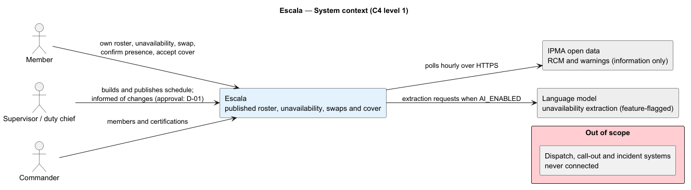
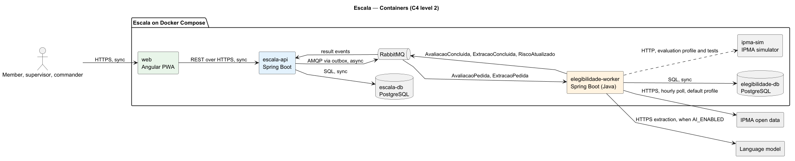
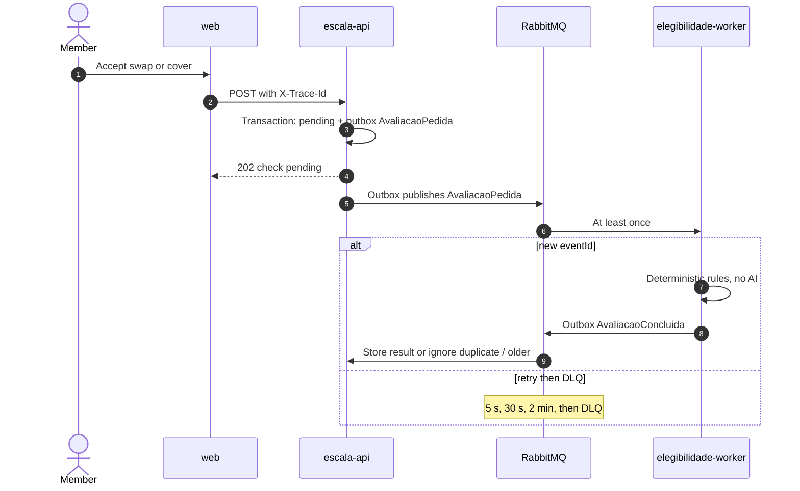
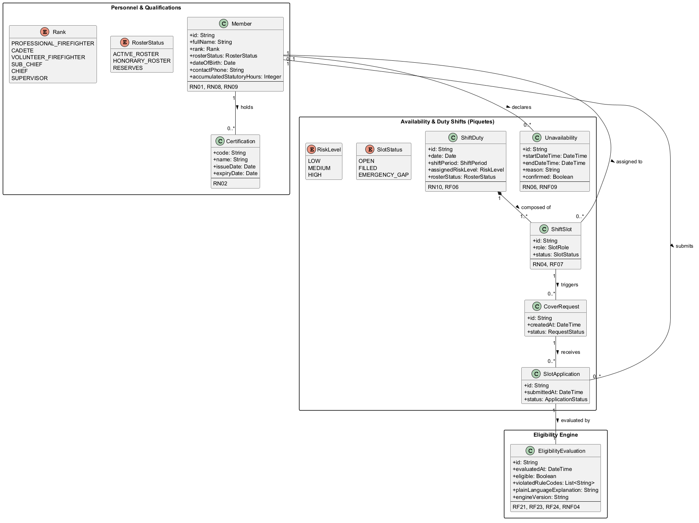
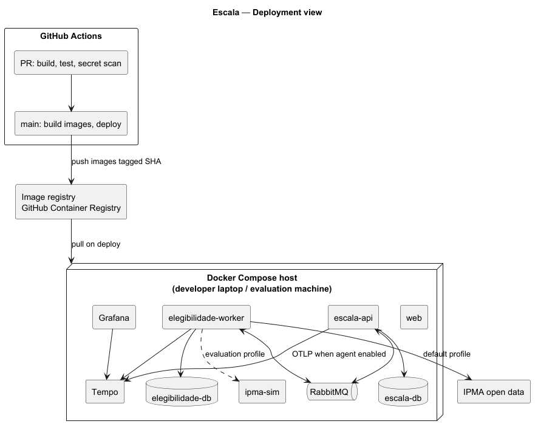

# Technical Design

| Field | Value |
|---|---|
| Status | Done |
| Deliverable | Sprint 1 · #7 Technical Design |
| Sources | Assignment §6, §7.1.2 #7; D-00; **04 · Product Vision**; **08 · Architecture Decision Records** |
| Jira | SCRUM-39 |

**Source of truth**

- This file in Git. Confluence **07 · Technical Design** is the same content, with the PlantUML exports below (Confluence does not render Mermaid).
- PlantUML: [`c4-system-context.puml`](c4-system-context.puml), [`c4-containers.puml`](c4-containers.puml), [`c4-deployment.puml`](c4-deployment.puml), [`domain_model.puml`](domain_model.puml), [`high_level_system_architecture.puml`](high_level_system_architecture.puml)
- Contracts: [`contracts/`](../../contracts/)
- ADR numbers: [ADR index](../adr/README.md) and **08 · Architecture Decision Records**

## Summary

Escala is a mobile roster for members of one volunteer fire corps: they see their shifts, say when they cannot serve, swap, confirm presence, and get cover requests only if they are free and qualified (**D-00**, UJ1 / UJ3 / UJ6). Angular PWA plus two Spring Boot Java 21 services ([ADR 0002](../adr/0002-split-backend-into-two-independently-deployable-components.md), [ADR 0015](../adr/0015-implement-elegibilidade-worker-in-java-with-spring-boot.md)). `escala-api` owns the published schedule and its changes; `elegibilidade-worker` runs deterministic function checks, text extraction and the IPMA poll. The client uses REST/HTTPS; the services use RabbitMQ ([ADR 0005](../adr/0005-use-rabbitmq-as-message-broker.md)). Each service has its own PostgreSQL ([ADR 0003](../adr/0003-one-postgresql-database-per-component.md)). AI extracts unavailability only, behind `AI_ENABLED` ([ADR 0011](../adr/0011-call-a-language-model-behind-a-feature-flag.md)); the planned extractor is Claude Haiku via the Claude Code CLI ([ADR 0016](../adr/0016-use-claude-haiku-through-the-claude-code-cli.md), *Proposed* until SCRUM-38). AI never decides swaps or cover ([ADR 0007](../adr/0007-deterministic-eligibility-engine-ai-never-decides.md), RF34 Won't). IPMA is **shown**, not used to set composition (RN10 off, RF27/RF28 Won't). Local and evaluation: Docker Compose (`docker compose up --build`). Cluster (team demo): Kubernetes + GitHub Actions + Argo CD. Readiness, never dispatch.

## Technology selection

Why these technologies, not others. Each row is an accepted ADR, except 0016 (*Proposed* until SCRUM-38). Same table as **High Level System Architecture**.

| Choice | Why it fits Escala | Rejected | ADR |
|---|---|---|---|
| Angular PWA | Roster on the phone without an app store; last-loaded roster readable offline (RNF06) | Native apps (two stores) | 0017 |
| Two Spring Boot Java 21 services | Roster writes stay up when a check or IPMA call is slow; same language on both backends | Monolith; Python worker | 0002, 0015 |
| PostgreSQL, one database per service | Each service owns its data; no foreign keys across the queue | Shared database | 0003 |
| RabbitMQ + outbox | At-least-once delivery; retries 5 s / 30 s / 2 min, then the DLQ; 202 without waiting (RNF02) | Synchronous REST between services; Kafka (operational cost) | 0005, 0009 |
| IPMA open data, hourly cache | Fire risk shown as information only | Using the RCM to size the *piquete* (RN10 off) | 0010, 0013 |
| Claude Haiku via CLI, `AI_ENABLED` | Extraction of unavailability only; the `evaluation` profile turns it off | AI that decides swaps or cover | 0007, 0011, 0016 |
| Docker Compose for evaluation | One command on a staff laptop (§12); Kubernetes with Argo CD stays the team's demo and release host | Kubernetes as the evaluation contract | 0018 |

**Where it runs.** Evaluation / walking skeleton: Docker Compose (`docker compose up --build`). That stack is the web PWA, two Java services, two PostgreSQL databases and RabbitMQ. Profile `observability` adds Tempo and Grafana. A profile `evaluation` that adds `ipma-sim` and sets `AI_ENABLED=false` is planned [TODO: not in `compose.yaml` yet; with the simulator, SCRUM-43]. Team demo host: Kubernetes overlays under `infra/k8s` (dev / qa / prod, Argo CD, duckdns). Compose is the evaluation contract.

## System context

Source: [`c4-system-context.puml`](c4-system-context.puml).

## Containers

Source: [`c4-containers.puml`](c4-containers.puml), [`high_level_system_architecture.puml`](high_level_system_architecture.puml). No arrow crosses into another component's database.

## Components and data ownership

No component reads another component's database ([ADR 0003](../adr/0003-one-postgresql-database-per-component.md)). The worker gets the facts it needs on the event ([ADR 0008](../adr/0008-events-carry-the-state-the-consumer-needs.md)).

| Component | Responsibility | Owns data | Talks to | Sync / async |
|---|---|---|---|---|
| `escala-api` | Published schedule, members, unavailability, swaps, presence, cover, audit; DailyRisk display read model | `escala-db` | `web`; RabbitMQ | Sync REST (from `web`); async events (RabbitMQ) |
| `elegibilidade-worker` | Function checks (RF21), extraction (RF31, ADR 0016), cached RCM (RF25, RF29) | `elegibilidade-db` | RabbitMQ; IPMA; Claude Code CLI | Async events (RabbitMQ); sync HTTP (IPMA); local process (Claude Code CLI) |
| `web` | Member and supervisor screens; roster offline (RNF06) | None | `escala-api` | Sync REST |
| `ipma-sim` | IPMA paths and §6.5 failures (`evaluation` profile; still to build, SCRUM-43) | None | `elegibilidade-worker` | Sync HTTP |

Split by question: published roster versus slow or external work. If the worker is down, `escala-api` still accepts unavailability, swap requests and cover accepts; applying a swap or filling a cover waits for a valid check (RF24).

## Asynchronous workflows

| Workflow | Trigger | Result | Why async |
|---|---|---|---|
| Function check | `AvaliacaoPedida` (`SWAP` / `COVER` / `ASSIGNMENT`) | `AvaliacaoConcluida` | Product path: 202 without waiting (RNF02); schedule changes only after `ELIGIBLE` (RF24). Walking skeleton `POST /api/v1/piquetes` returns 201 + `Location` |
| Extraction | `ExtracaoPedida` | `ExtracaoConcluida` | Model may be down; form stays up (RF35) |
| Risk update | Hourly poll | `RiscoAtualizado` | Display only; does not change slots |

**Eligibility flow (outbox, idempotency, DLQ):** the walking-skeleton `POST /api/v1/piquetes` returns **201** + `Location`; **202** is the later contract for swaps and cover (the sequence above). The API writes pending state and an outbox row in one transaction; the outbox publishes `AvaliacaoPedida`; the worker ignores a duplicate `eventId` or stores the result and publishes `AvaliacaoConcluida`; failures retry after 5 s, 30 s and 2 min, then the dead-letter queue.

## Reliability of messaging

| §6.3 | Mechanism |
|---|---|
| Retries | 5 s / 30 s / 2 min then DLQ ([ADR 0005](../adr/0005-use-rabbitmq-as-message-broker.md)) |
| Duplicates | `eventId` in the same transaction ([ADR 0009](../adr/0009-transactional-outbox-and-idempotent-consumers.md), RNF05) |
| Failures | Transactional outbox, then DLQ ([ADR 0009](../adr/0009-transactional-outbox-and-idempotent-consumers.md)) |
| Eventual consistency | pending / evaluated / failed; swap or cover not applied without a valid check ([ADR 0008](../adr/0008-events-carry-the-state-the-consumer-needs.md), RF24) |

Exchange `escala.events`. Consumers ignore a result older than the stored one (`outdated`). `ExtracaoPedida` holds free text: purge the DLQ after 7 days (**09 · Security and Privacy Assessment**).

## External integration — IPMA

Endpoints: RCM `rcm-d{0,1,2}.json`; warnings `warnings_www.json`. Poll hourly by the worker ([ADR 0010](../adr/0010-poll-ipma-hourly-and-cache-the-last-valid-value.md)). DICO **1312**. Timeout **5 s**, two retries. Staleness **3 h**: show age and an assumed-higher *warning*; **do not** add slots ([ADR 0013](../adr/0013-assume-the-higher-risk-when-ipma-data-is-unusable.md), D-00). Cite IPMA as the source, with a link to its site, wherever its data is shown, and notify `webmaster@ipma.pt` (**AI Usage and Third-Party Attribution**).

| §6.5 | Detection | Behaviour |
|---|---|---|
| Unavailable | Timeout 5 s or HTTP error | Last cache + age; after 3 h, warning |
| Delayed | Old `dataPrev` / `fileDate` | Same |
| Incomplete | DICO missing | Keep last value for our municipality |
| Invalid | Bad JSON or RCM not 1–5 | Reject; keep last valid |

Simulator: `tools/ipma-sim`, `IPMA_SIM_MODE=ok` / `unavailable` / `delayed` / `incomplete` / `invalid`, for tests and the Compose profile `evaluation` (§12) [TODO: not built yet, SCRUM-43].

## Degraded modes

| Down | Behaviour | Message |
|---|---|---|
| IPMA | Last RCM + age; warning only | "Fire risk from IPMA last updated {age}. Level may be higher than shown. The schedule is unchanged." |
| AI | Form fallback (RF35, ADR 0011); the `evaluation` profile sets `AI_ENABLED=false` | "Automatic reading is unavailable. Please enter the dates in the form." |
| Worker or RabbitMQ | Requests 202; swap/cover not applied | "Check pending. Your shift will update when the check completes." |

If Escala itself is down, the corps uses the phone. Runbook: [Deployment and Operations](../operations/deployment-and-operations.md).

## Data model

Source: [`domain_model.puml`](domain_model.puml). Cross-service IDs are references on events, never foreign keys. Instants in UTC; PWA shows `Europe/Lisbon` ([ADR 0012](../adr/0012-store-instants-in-utc.md)).

- `escala-db` (blue): Member, Certification, DrivingLicence, ServiceHoursEntry, Vehicle, Piquete, Slot, Assignment, DailyRisk (display only), Unavailability, FreeTextMessage (deleted after confirmation), SwapRequest, PresenceConfirmation, CoverRequest, Application, Notification, AuditRecord, outbox.
- `elegibilidade-db` (orange): EligibilityEvaluation (`purpose` SWAP/COVER/ASSIGNMENT), ViolatedRule, UnavailabilityExtraction, RiskObservation, WeatherWarning, outbox.

Consistency is strong inside each database and eventual between services (visible states). Free text is deleted after confirmation (RNF09). No names, contacts or date of birth leave `escala-db`; free text leaves once in `ExtracaoPedida`.

**D-01** (supervisor informed of swaps by default; approval per corps) and **D-02** (nobody accepts a cover: supervisor escalation and exceptional assignment with a reason) were decided by the PO on 2026-10-31 (SCRUM-50, SCRUM-51); see the **Investor Decision Log**.

## API outline

- REST: [`contracts/openapi.yaml`](../../contracts/openapi.yaml)
- Events: [`contracts/events/`](../../contracts/events/) — envelope `eventId`, `type`, `schemaVersion`, `occurredAt`, `traceId`
- Auth: mocked bearer token with `memberId` and `role` ([ADR 0006](../adr/0006-mock-authentication-and-enforce-roles.md)); health endpoints stay open
- Header: `X-Trace-Id` (RF37)

Walking skeleton: `POST /api/v1/piquetes` (201 + `Location`, slot `PENDING`) · worker `SEMPRE_ELEGIVEL` · `ELIGIBLE` · today's piquete PWA (SCRUM-45/46/47). Product API (planned): `GET /me/roster` · `POST /piquetes/{id}/publish` · `POST /unavailabilities` (202) · `POST /swaps` · `POST /swaps/{id}/accept` · `POST /slots/{id}/presence` · `POST /cover-requests/{id}/accept` · `POST /assignments/{id}/confirm` (RF24) · `GET /risk/today`. Health: `/actuator/health` with `liveness` and `readiness` groups (RF36).

## Deployment view

Source: [`c4-deployment.puml`](c4-deployment.puml). Local and evaluation: `docker compose up --build` (PWA `http://localhost:8000` proxies `/api/` to the API; API `http://localhost:8080/actuator/health`; worker `:8081`). Observability: Tempo and Grafana (`--profile observability`, Grafana `http://localhost:3000`). Evaluation profile with `ipma-sim`: still to build (SCRUM-43). Java images include the OpenTelemetry agent (`JAVA_TOOL_OPTIONS`); Compose sets `OTEL_JAVAAGENT_ENABLED=false` unless tracing is on. On some Windows hosts port 5672 is excluded by Hyper-V; map RabbitMQ to `RABBITMQ_PORT` in `.env` (container AMQP stays 5672).

Kubernetes overlays under `infra/k8s` are the team demo host (GitHub Actions, GHCR, Argo CD; `https://escala-dev.duckdns.org`, `escala-qa.duckdns.org`, `escala-prod.duckdns.org`). Teaching-staff evaluation is Docker Compose.

Compose sets `SPRING_RABBITMQ_DYNAMIC=false`. Topology comes from `infra/rabbitmq/setup.sh` (the `escala-api` user cannot declare exchanges). Runbook: [Deployment and Operations](../operations/deployment-and-operations.md).

## Observability and SLIs

- Logs: timestamp + level + `trace_id` in the pattern; JSON logs are SCRUM-48; never contacts or free text
- Health: `/actuator/health`, `/actuator/health/liveness` and `/actuator/health/readiness` (RF36; through the web proxy `/api/actuator/...`). Today `/actuator/health` reports DOWN when RabbitMQ is down, but the readiness group does not yet include the database or the broker, and the Kubernetes probes use `/actuator/health`. Both are fixed in SCRUM-88 (Sprint 2).
- Traces: OpenTelemetry Java agent in both images; Tempo; Grafana. Kubernetes also runs Loki and Alloy.
- Metrics: checks, DLQ, IPMA age, extraction fallbacks, time-to-fill (RF38)
- Dashboard: Grafana `http://localhost:3000` (RF39)
- SLI 1: function-check p95 < 5 s (RNF01), from `AvaliacaoPedida` outbox to applied `AvaliacaoConcluida`
- SLI 2: ≥ 95 % of checks without DLQ replay or exceptional assignment

## Done when

- [x] §7.1.2 #7 covered: system context, containers, data model, API, async workflow, IPMA, deployment
- [x] Content matches D-00 (UJ1 / UJ3 / UJ6); D-01 and D-02 decided (SCRUM-50, SCRUM-51)
- [x] This file pasted to Confluence **07 · Technical Design**
- [x] PlantUML exported on Confluence (system context, containers, deployment, domain model)
- [x] Reviewed by another team member
- [x] Status set to Done
