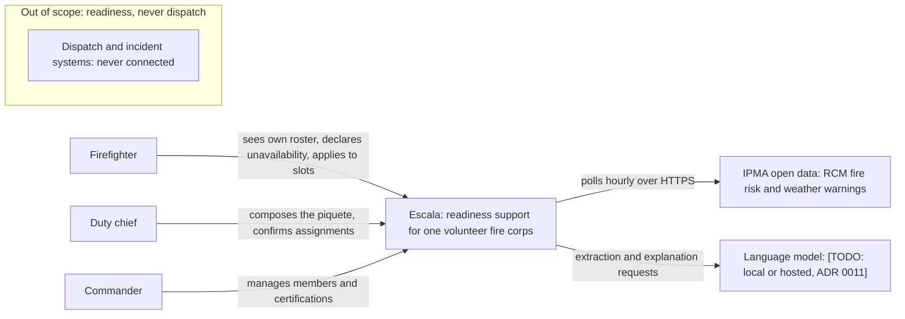
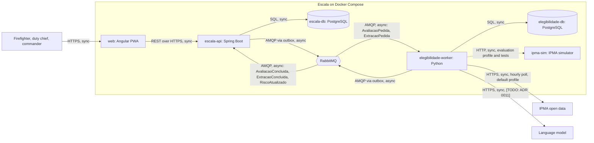
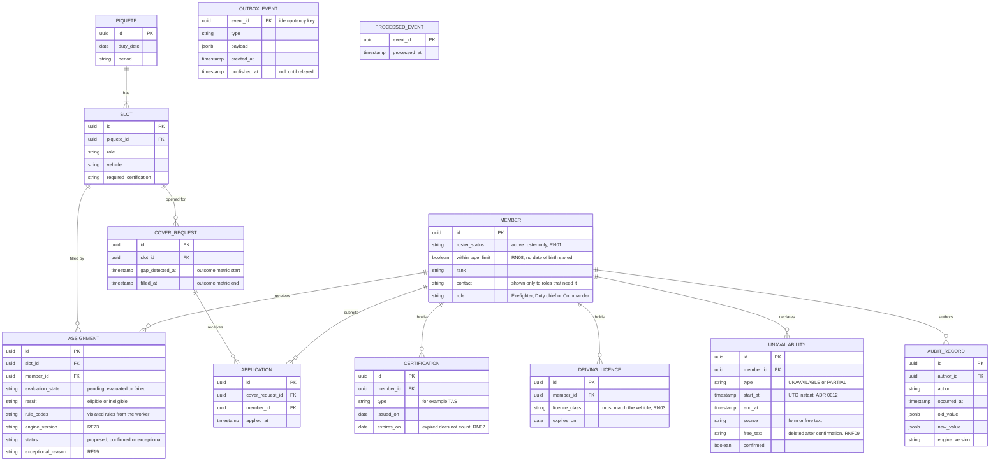
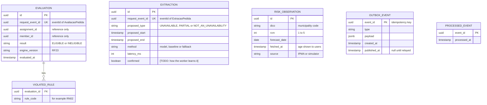
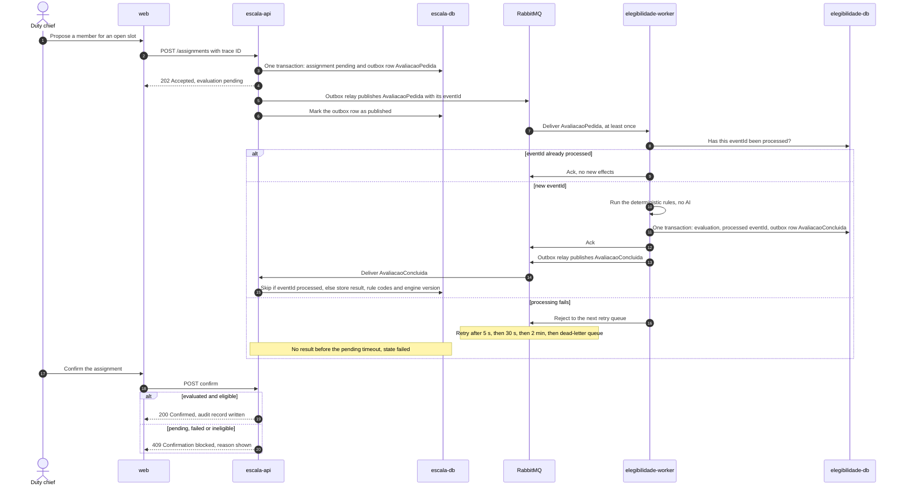
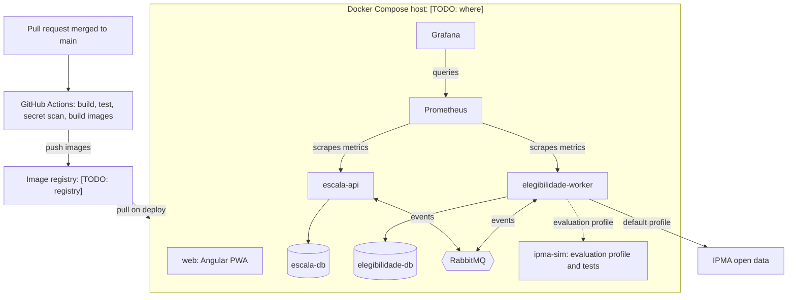

# Technical Design

| Field | Value |
|---|---|
| Status | Draft |
| Owner | [TODO: name] |
| Contributors | [TODO: names] |
| Deliverable | Sprint 1 · #7 Technical Design (full version); Final submission · #4 Architecture documentation |
| Sources | Assignment §6, §6.1–§6.8, §7.1.2 #7, §9, §12 |
| Confluence page | **07 · Technical Design** |
| Last updated | YYYY-MM-DD |

> **ℹ️ About this document.** The full technical design of Escala, the readiness-support app for a *Corpo de Bombeiros Voluntários* (volunteer fire corps): C4 views, data ownership, data model, API and event contracts, the eligibility flow, the IPMA integration, degraded modes, deployment and observability, with every diagram kept as code next to the code. The Confluence page **07 · Technical Design** summarises it and exports its diagrams; when the two disagree, update this document first. Developers read it before changing a boundary, a contract or a queue. ADR numbers refer to the [ADR index](../adr/README.md).

> **ℹ️ Guidance.** §9: "Teams should prefer documentation generated from or maintained close to the source code where appropriate." Change this file in the same pull request as the code it describes, and replace each `[TODO: …]` with the decision or with the Jira issue or *Proposed* ADR that will settle it. §6: "All significant technical decisions must be justified." Point every choice to its ADR rather than arguing it here.

## Summary

> **ℹ️ Guidance.** One paragraph: the client, the backend components, how they communicate, where data lives, the external integration, and how the system is deployed and observed. Keep it consistent with the Summary on **07 · Technical Design**; this version may add detail and ADR numbers.

[TODO: one paragraph]

> **✏️ Example (illustrative — replace).** Escala tells a volunteer fire corps whether the people on today's *piquete* can actually crew the vehicles, given today's fire risk. It is an Angular PWA backed by two independently deployable components (ADR 0002). `escala-api` (Spring Boot) owns what the piquete needs: people, rosters, slots, unavailability, requests and audit. `elegibilidade-worker` (Python) works out who can fill it: it runs the deterministic eligibility rules (ADR 0007), polls IPMA fire risk hourly (ADR 0010) and runs the AI extraction, but the AI never decides eligibility. The two exchange events through RabbitMQ with a transactional outbox, idempotency keys, retries and a dead-letter queue (ADR 0005, ADR 0009), and each owns its own PostgreSQL database (ADR 0003). Everything runs in Docker Compose, is built and deployed by GitHub Actions, and is observed with Prometheus and Grafana. Escala is about readiness, never dispatch.

## System context

> **ℹ️ Guidance.** C4 level 1: Escala as one box, the people who use it and the external systems it depends on. Keep the boundary visible: no dispatch or incident system is connected. Export the rendered diagram to **07 · Technical Design** whenever it changes.

> **✏️ Example (illustrative — replace).** Starting draft from the proposed ADRs; edit it until it matches the product.



## Containers

> **ℹ️ Guidance.** C4 level 2: one box per deployable unit and one per data store, every arrow labelled with its protocol and whether it is sync or async. §6.2 requires "at least two independently deployable backend components"; ADR 0002 justifies them. No arrow may cross from one component into the other component's database.

> **✏️ Example (illustrative — replace).** Starting draft; `ipma-sim` replaces IPMA in tests and in the `evaluation` profile.



## Components and data ownership

> **ℹ️ Guidance.** One row per deployable component, the same rows as **07 · Technical Design**. Then answer each §6.2 point in one line and name its ADR. No component reads another component's database; the worker gets what it needs from the event (ADR 0008).

| Component | Responsibility | Owns data | Talks to | Sync / async |
|---|---|---|---|---|
| [TODO: component] | [TODO: responsibility] | [TODO: database] | [TODO: components and systems] | [TODO: sync / async, protocol] |

> **✏️ Example (illustrative — replace).**
>
> | Component | Responsibility | Owns data | Talks to | Sync / async |
> |---|---|---|---|---|
> | `escala-api` (Spring Boot) | What the piquete needs: people, rosters, slots, unavailability, requests, audit; required composition for the day's risk (RF27, RF28) | `escala-db` | `web`; RabbitMQ | Sync REST with `web`; async events with the worker |
> | `elegibilidade-worker` (Python) | Who can fill it: eligibility evaluations (versioned engine, RF23), AI extraction with `dateparser` + rules baseline, explanations from rule codes only, observed risk | `elegibilidade-db` | RabbitMQ; IPMA; language model | Async events; sync HTTP to IPMA and the model |
> | `web` (Angular PWA) | Screens for firefighters, duty chiefs and commanders; roster readable offline (RNF06) | None (browser cache only) | `escala-api` | Sync REST |
> | `ipma-sim` | Imitates the IPMA endpoints and their failures for tests and the `evaluation` profile | None | `elegibilidade-worker` | Sync HTTP |

### Why these boundaries (§6.2)

| §6.2 point | Decision | ADR |
|---|---|---|
| Component or service boundaries | [TODO: decision] | 0002 |
| Responsibilities and data ownership | [TODO: decision] | 0003 |
| Synchronous and asynchronous communication | [TODO: decision] | 0005, 0008 |
| Coupling and cohesion | [TODO: decision] | 0008 |
| Deployment implications | [TODO: decision] | 0002, 0004 |
| Failure handling | [TODO: decision] | 0009, 0013 |

> **✏️ Example (illustrative — replace).** *Boundaries:* split by question: "what the piquete needs" against "who can fill it". *Coupling:* events carry the state the rules need, so the worker never calls back into `escala-api`. *Deployment:* two images built from one monorepo, each deployable and restartable on its own. *Failure handling:* if the worker stops, `escala-api` keeps accepting requests and evaluations wait as "pending".

## Data model

> **ℹ️ Guidance.** One ER diagram per database, with the main entities, keys and the fields the business rules need (RN IDs from **Requirements and Quality Attributes**). IDs that point into the other component's data are plain references, never foreign keys. Use one PostgreSQL per component (ADR 0003), in line with §6.4: "Teams should not introduce multiple database technologies unless the product requirements justify the additional complexity." Answer the remaining §6.4 points in the table below.

### `escala-db` (owned by `escala-api`)

> **✏️ Example (illustrative — replace).** Starting draft; field names are suggestions.



### `elegibilidade-db` (owned by `elegibilidade-worker`)

> **✏️ Example (illustrative — replace).** Starting draft; `assignment_id` and `member_id` are references to `escala-api` data, not foreign keys.



### §6.4 data concerns

| §6.4 point | Decision |
|---|---|
| Consistency requirements | [TODO: decision] |
| Data lifecycle | [TODO: decision] |
| Retention and deletion | [TODO: decision; keep in line with **09 · Security and Privacy Assessment**] |
| Backup or recovery considerations | [TODO: decision] |
| Relevant privacy constraints | [TODO: decision] |

> **✏️ Example (illustrative — replace).**
>
> | §6.4 point | Decision |
> |---|---|
> | Consistency requirements | Strong inside each database; eventual between components, made visible as pending / evaluated / failed |
> | Retention and deletion | Free text deleted after confirmation (RNF09); other periods as on **09 · Security and Privacy Assessment** |
> | Backup or recovery considerations | [TODO: backup tool and frequency]; the outbox lets events be re-sent after a restore |
> | Relevant privacy constraints | No names, contacts or free text leave `escala-db` except the free text sent once for extraction |

## API outline

> **ℹ️ Guidance.** [`contracts/openapi.yaml`](../../contracts/openapi.yaml) [TODO: not yet created] is the source of truth; change it in the same pull request as the endpoint and cover it with a contract test (see [Test Strategy](../testing/test-strategy.md)). List only the main endpoints here, with the roles allowed (from the access-control matrix on **09 · Security and Privacy Assessment**) and the requirement they serve.

- REST contract: [`contracts/openapi.yaml`](../../contracts/openapi.yaml) [TODO: file not yet created]
- Rendered API docs: [TODO: URL, or how to generate them]
- Authentication: mocked token carrying member ID and role, checked on every business endpoint (ADR 0006); `/health` and `/health/ready` stay open for the container runtime and Prometheus [TODO: confirm]
- Trace ID header: [TODO: header name]
- Error format: [TODO: error format]

| Endpoint | Purpose | Roles | Requirement |
|---|---|---|---|
| [TODO: method and path] | [TODO: purpose] | [TODO: roles] | [TODO: RF / RNF ID] |

> **✏️ Example (illustrative — replace).**
>
> | Endpoint | Purpose | Roles | Requirement |
> |---|---|---|---|
> | `POST /piquetes` | Create a piquete for a date and period with its slots | Duty chief, Commander [TODO: confirm] | RF06, ESC-23 |
> | `POST /assignments` | Propose a member for a slot; answers 202 and publishes `AvaliacaoPedida` | Duty chief, Commander | RF08 |
> | `GET /slots/{id}/candidates` | Eligible and ineligible candidates with reasons | Duty chief, Commander | RF16 |
> | `POST /assignments/{id}/confirm` | Confirm; refused while no valid evaluation exists | Duty chief, Commander | RF18, RF24 |
> | `POST /unavailabilities` | Declare unavailability by form or free text; answers 202 without waiting for evaluation | Firefighter, Duty chief, Commander | RF12, RF13, RNF02 |
> | `GET /health`, `GET /health/ready` | Liveness and readiness, on both services | None (infrastructure) | RF36 |

## Asynchronous workflows

> **ℹ️ Guidance.** §6.3 requires "at least one meaningful asynchronous workflow". Keep the same rows as **07 · Technical Design**, say why each one cannot be a synchronous call, and draw the sequence of the principal one (eligibility) with the outbox, the idempotency check, the retries and the dead-letter queue.

| Workflow | Trigger event | Result event | Why async |
|---|---|---|---|
| Eligibility | `AvaliacaoPedida` (evaluation requested), `escala-api` → worker | `AvaliacaoConcluida` (evaluation completed), worker → `escala-api` | [TODO: why] |
| Extraction | `ExtracaoPedida` (extraction requested), `escala-api` → worker | `ExtracaoConcluida` (extraction completed), worker → `escala-api` | [TODO: why] |
| Risk update | Hourly IPMA poll in the worker (timer, no incoming event) | `RiscoAtualizado` (risk updated), worker → `escala-api` | [TODO: why] |

> **✏️ Example (illustrative — replace).** *Eligibility:* the API accepts the request without waiting for the evaluation (RNF02), so a slow or stopped worker never freezes the duty chief's screen. *Extraction:* the language model can be slow or down, and the form flow must keep working regardless. *Risk update:* IPMA is external and polled on a schedule; `escala-api` reacts to the new risk level instead of calling IPMA itself.

### Eligibility flow

> **✏️ Example (illustrative — replace).** Starting draft of the eligibility flow; status codes and the pending timeout are proposals.



When nobody is eligible, decision D-02 on **Investor Decision Log** settles whether the assignment is blocked or recorded as an exceptional assignment with a written reason (RF19): [TODO: outcome of D-02].

## Event contracts

> **ℹ️ Guidance.** One JSON Schema per event in [`contracts/events/`](../../contracts/events/) [TODO: folder not yet created], checked by contract tests on both sides. Events carry only the state the consumer needs (ADR 0008): no names, no contacts, no date of birth, and free text only in `ExtracaoPedida`. Every event has the same envelope; a breaking change gets a new `schemaVersion`, and consumers accept both versions during the rollout.

- **Envelope:** `eventId` (UUID, also the idempotency key), `type`, `schemaVersion`, `occurredAt` (UTC instant, ADR 0012), `traceId` (RF37)
- **Display time zone:** [TODO: time zone the PWA shows, e.g. Europe/Lisbon]

| Event | Producer | Consumer | Schema file |
|---|---|---|---|
| `AvaliacaoPedida` | `escala-api` | `elegibilidade-worker` | [TODO: file] |
| `AvaliacaoConcluida` | `elegibilidade-worker` | `escala-api` | [TODO: file] |
| `ExtracaoPedida` | `escala-api` | `elegibilidade-worker` | [TODO: file] |
| `ExtracaoConcluida` | `elegibilidade-worker` | `escala-api` | [TODO: file] |
| `RiscoAtualizado` | `elegibilidade-worker` | `escala-api` | [TODO: file] |

> **✏️ Example (illustrative — replace).** An `AvaliacaoPedida` carrying only what the rules need. The member appears by ID only, and `withinAgeLimit: true` replaces a date of birth (RN08).
>
> ```json
> {
>   "eventId": "6f1c2d3e-0000-4000-8000-000000000001",
>   "type": "AvaliacaoPedida",
>   "schemaVersion": 1,
>   "occurredAt": "2026-10-15T07:42:10Z",
>   "traceId": "4bf92f3577b34da6a3ce929d0e0e4736",
>   "assignmentId": "6f1c2d3e-0000-4000-8000-000000000002",
>   "slot": {
>     "slotId": "6f1c2d3e-0000-4000-8000-000000000003",
>     "start": "2026-10-15T08:00:00Z",
>     "end": "2026-10-15T20:00:00Z",
>     "requiredCertification": "TAS",
>     "requiredLicenceClass": "C"
>   },
>   "candidate": {
>     "memberId": "6f1c2d3e-0000-4000-8000-000000000004",
>     "inActiveRoster": true,
>     "withinAgeLimit": true,
>     "certifications": [
>       { "type": "TAS", "expiresOn": "2026-09-30" }
>     ],
>     "licenceClasses": ["B", "C"],
>     "unavailabilities": [],
>     "otherAssignments": [
>       { "start": "2026-10-14T20:00:00Z", "end": "2026-10-15T08:00:00Z" }
>     ]
>   }
> }
> ```
>
> With this input the engine answers `AvaliacaoConcluida` with `result: "INELIGIBLE"`, `violatedRules: ["RN02"]` (the TAS expired before the slot starts) and its `engineVersion`. Minimum rest (RN07) cannot be checked until the internal regulation is obtained. Licence classes are illustrative; the class each vehicle needs is still to confirm (RN03, verify).

## Reliability of messaging

> **ℹ️ Guidance.** §6.3: the workflow "should demonstrate appropriate handling of retries, duplicate events, failures, and eventual consistency." Name one mechanism per concern, its ADR and the test that proves it in [Test Strategy](../testing/test-strategy.md). Keep the retry schedule identical to **07 · Technical Design**.

| §6.3 concern | Mechanism | ADR | Test |
|---|---|---|---|
| Retries | [TODO: mechanism] | [TODO: ADR] | [TODO: TC ID] |
| Duplicate events | [TODO: mechanism] | [TODO: ADR] | [TODO: TC ID] |
| Failures | [TODO: mechanism] | [TODO: ADR] | [TODO: TC ID] |
| Eventual consistency | [TODO: mechanism] | [TODO: ADR] | [TODO: TC ID] |

> **✏️ Example (illustrative — replace).**
>
> | §6.3 concern | Mechanism | ADR | Test |
> |---|---|---|---|
> | Retries | Retry queues after 5 s, 30 s and 2 min, then the dead-letter queue (DLQ) | 0005 | Integration: the worker fails twice, then succeeds |
> | Duplicate events | Idempotency key per event: the consumer stores the `eventId` in the same transaction as the effect and ignores a second delivery (RNF05) | 0009 | Integration: the same event delivered twice gives one evaluation |
> | Failures | Transactional outbox: the event is written in the same transaction as the state change, then relayed to RabbitMQ. After the last retry the message goes to the DLQ and shows on the dashboard | 0009 | Integration: broker stopped during a request, event published after restart |
> | Eventual consistency | Visible states: pending / evaluated / failed. Confirmation stays blocked while no valid evaluation exists (RF24) | 0008 | End-to-end: confirmation refused while pending |

### Queues and the dead-letter queue

- Exchanges and queues: [TODO: names]
- Outbox relay interval: [TODO: seconds]
- Ordering: [TODO: how a consumer ignores a stale result, e.g. an older evaluation arriving after a newer one]
- DLQ: alert when it is not empty; replay and purge steps in [Deployment and Operations](../operations/deployment-and-operations.md). `ExtracaoPedida` messages hold free text, so they are purged after [TODO: days] (see **09 · Security and Privacy Assessment**)

> **✏️ Example (illustrative — replace).** One topic exchange for Escala events; one queue per consumer and event type; three retry queues with a message time-to-live of 5 s, 30 s and 2 min that dead-letter back to the main queue; a retry-count header decides when a message moves to the DLQ.

## External integration — IPMA

> **ℹ️ Guidance.** §6.5: "The application must handle unavailable, delayed, incomplete, or invalid external data appropriately." Keep the four cases identical to **07 · Technical Design**, add how each is tested with the simulator, and record the thresholds as configuration (ADR 0014). The IPMA terms of use require citing the source and notifying `webmaster@ipma.pt` (see **AI Usage and Third-Party Attribution**).

- Rural fire risk (RCM 1–5 per municipality, by DICO code) for today and the next two days: `https://api.ipma.pt/open-data/forecast/meteorology/rcm/rcm-d{0,1,2}.json`
- Weather warnings: `https://api.ipma.pt/open-data/forecast/warnings/warnings_www.json`; how a warning maps to our area: [TODO: verify the area field]
- Polling: hourly, by `elegibilidade-worker`, with the last valid value cached in `elegibilidade-db` (ADR 0010); each poll publishes `RiscoAtualizado`
- Our municipality's DICO code: [TODO: DICO]
- Request timeout and retries per poll: [TODO: seconds, count]
- Staleness threshold: [TODO: hours]; beyond it, assume the higher risk level (ADR 0013)
- Attribution shown in the UI: [TODO: text]; IPMA notified on [TODO: date]

| §6.5 case | Detection | Behaviour | Test (simulator mode) |
|---|---|---|---|
| Unavailable | [TODO: detection] | [TODO: behaviour] | [TODO: mode / TC ID] |
| Delayed | [TODO: detection] | [TODO: behaviour] | [TODO: mode / TC ID] |
| Incomplete | [TODO: detection] | [TODO: behaviour] | [TODO: mode / TC ID] |
| Invalid | [TODO: detection] | [TODO: behaviour] | [TODO: mode / TC ID] |

> **✏️ Example (illustrative — replace).**
>
> | §6.5 case | Detection | Behaviour | Test (simulator mode) |
> |---|---|---|---|
> | Unavailable | Timeout ([TODO: s]) or HTTP error | Serve the last cached value with its age; beyond the staleness threshold, assume the higher risk level (ADR 0013) | Simulator answers 503 or never answers |
> | Delayed | The data's reference date is older than expected (verify the field) | Same as unavailable: show the age; beyond the threshold, assume the higher risk level | Simulator serves yesterday's file |
> | Incomplete | Our DICO code is missing from the response | Keep the last value for our municipality; log a warning with the trace ID | Simulator drops our DICO code |
> | Invalid | Schema validation fails, or an RCM value is outside 1–5 | Reject the whole response, keep the last valid value and increment an error metric | Simulator returns malformed JSON or RCM 7 |

**IPMA simulator.** `tools/ipma-sim` serves the same endpoints and reproduces each case above on demand. Tests and the `evaluation` profile use it, so the product runs offline in the evaluation environment (§12). Modes and how to switch them: [TODO: modes and switch, e.g. environment variable or admin endpoint].

## Degraded modes

> **ℹ️ Guidance.** §6.8: "The product should fail safely and communicate limitations clearly to users." Keep the rows and messages identical to **07 · Technical Design**, and add how each failure is detected and how it is demonstrated. If Escala itself is down, the corps goes back to the phone. The step-by-step runbook is in [Deployment and Operations](../operations/deployment-and-operations.md).

| Dependency down | Behaviour | Message to the user | Detection | Demonstrated by |
|---|---|---|---|---|
| IPMA | [TODO: behaviour] | [TODO: message] | [TODO: detection] | [TODO: demo / TC ID] |
| AI service | [TODO: behaviour] | [TODO: message] | [TODO: detection] | [TODO: demo / TC ID] |
| `elegibilidade-worker` | [TODO: behaviour] | [TODO: message] | [TODO: detection] | [TODO: demo / TC ID] |
| [TODO: other dependency, e.g. RabbitMQ, network connection] | [TODO: behaviour] | [TODO: message] | [TODO: detection] | [TODO: demo / TC ID] |

> **✏️ Example (illustrative — replace).**
>
> | Dependency down | Behaviour | Message to the user | Detection | Demonstrated by |
> |---|---|---|---|---|
> | IPMA | Last value shown with its age; beyond the threshold, the higher risk level is assumed | "Fire risk from IPMA last updated 3 h ago. Showing the higher level until IPMA responds." | Failed polls; data-age metric above the threshold | Simulator in "unavailable" mode |
> | AI service | Free-text box replaced by the unavailability form (RF35) | "Automatic reading is unavailable. Please enter the dates in the form." | Extraction timeout or error; feature flag off | Stop the model or turn the flag off |
> | `elegibilidade-worker` | Evaluations stay "pending"; confirmation is blocked | "Eligibility check pending. You can confirm once the check is complete." | No `AvaliacaoConcluida`; queue depth grows | Stop the worker container, then restart it and watch the backlog drain |

## Deployment view

> **ℹ️ Guidance.** Show where each container runs, how it gets there (the pipeline) and which profile it belongs to: `default`, or `evaluation` (IPMA simulator and AI fallback, runs offline, §12). Commands, configuration, secrets and rollback live in [Deployment and Operations](../operations/deployment-and-operations.md); link to it rather than copying them.

- Environment: [TODO: where it is deployed]
- URL: [TODO: URL]
- Image registry: [TODO: registry, or built on the host]

> **✏️ Example (illustrative — replace).** Starting draft of the deployment view.



## Observability and SLIs

> **ℹ️ Guidance.** §6.7 sets a minimum: structured application logs, health checks, relevant metrics, correlation or trace identifiers, error reporting and a small operational dashboard. Say where each one is and how the trace ID travels from `web` through `escala-api` and the event to `elegibilidade-worker`. Give each SLI a precise definition, a target and the metric it comes from; keep the two SLIs identical to **07 · Technical Design**.

- Logs: [TODO: format and where to read them]; never contacts or free text (see **09 · Security and Privacy Assessment**)
- Trace ID: created at [TODO: web or the API edge], sent as an HTTP header and as `traceId` in every event (RF37)
- Health checks: `/health` (liveness) and `/health/ready` (readiness: database and broker reachable) on both services (RF36)
- Metrics: [TODO: main metrics], exposed to Prometheus (RF38)
- Error reporting: [TODO: how errors surface to the team]
- Dashboard: Grafana — [TODO: link] (RF39)

| SLI | Definition | Target | Measured from | Shown on |
|---|---|---|---|---|
| Eligibility evaluation p95 latency | [TODO: from which timestamp to which] | < 5 s (RNF01) | [TODO: metric] | [TODO: dashboard panel] |
| % of requests evaluated without manual intervention | [TODO: what counts as manual intervention] | [TODO: %] | [TODO: metric] | [TODO: dashboard panel] |

> **✏️ Example (illustrative — replace).** Log line fields: `timestamp` (UTC), `level`, `service`, `traceId`, `eventId`, `message`. Metrics: evaluations requested / completed / failed, evaluation duration from the outbox row of `AvaliacaoPedida` to `AvaliacaoConcluida` applied, DLQ size, age of the IPMA data served, and how many extractions fell back to the form. "Manual intervention" counts DLQ replays and exceptional assignments.

## Done when
- [ ] Every §7.1.2 #7 item is covered: System context; Container or component view; Data model; API outline; Asynchronous workflow; External integration; Deployment view
- [ ] All Mermaid diagrams render on GitHub and match the code: Docker Compose file, `contracts/openapi.yaml`, `contracts/events/`
- [ ] Components, events, retry schedule, IPMA cases, degraded modes and SLIs agree with **07 · Technical Design**, and its exported diagrams are current
- [ ] Every remaining `[TODO: …]` points to a Jira issue or a *Proposed* ADR
- [ ] Reviewed by another team member
- [ ] Guidance and example blocks removed
- [ ] Status set to Done
