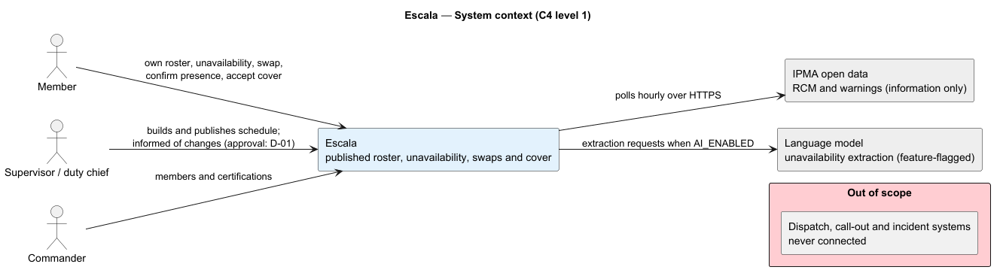
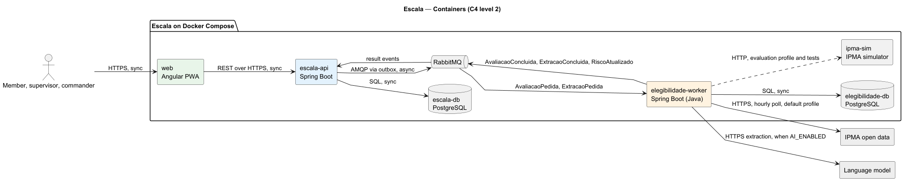
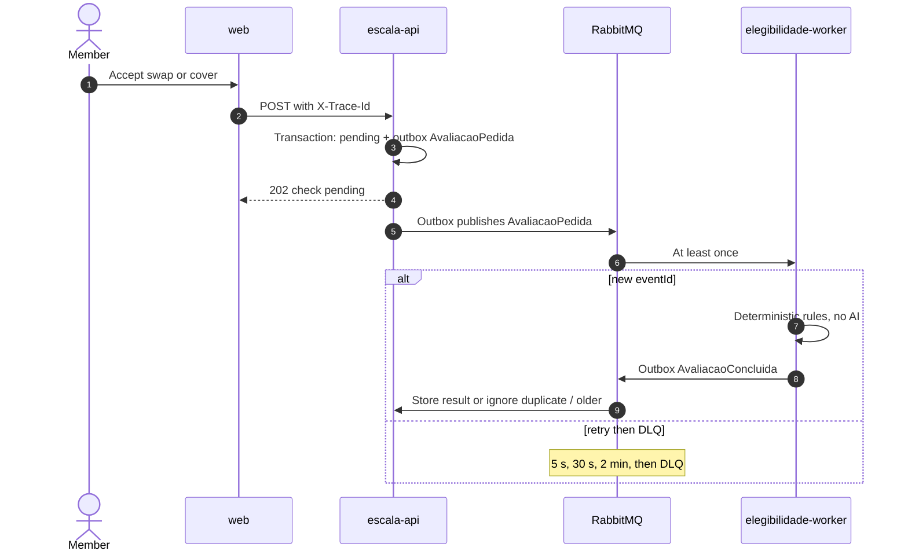
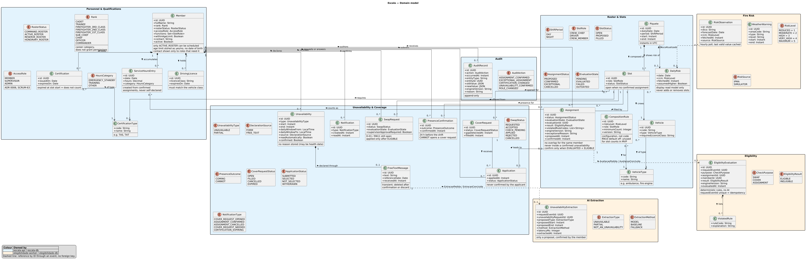
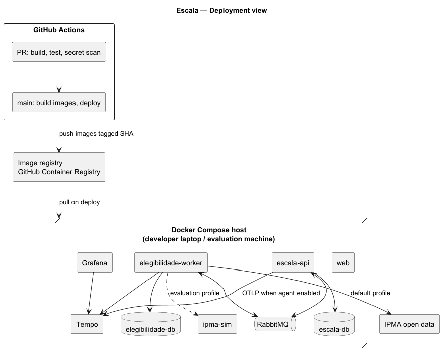

# Technical Design

| Field | Value |
|---|---|
| Status | Done |
| Deliverable | Sprint 1 · #7 Technical Design |
| Sources | Assignment §6, §7.1.2 #7; D-00; **04 · Product Vision**; **08 · Architecture Decision Records** |
| Jira | SCRUM-39 |

**Source of truth**

- This file in Git. Confluence **07 · Technical Design** is the same content, with the PlantUML exports below (Confluence does not render Mermaid).
- PlantUML: [`c4-system-context.puml`](c4-system-context.puml), [`c4-containers.puml`](c4-containers.puml), [`c4-deployment.puml`](c4-deployment.puml), [`domain_model.puml`](domain_model.puml), [`high_level_system_architecture.puml`](high_level_system_architecture.puml)
- Contracts: [`contracts/`](../../contracts/)
- ADR numbers: [ADR index](../adr/README.md) and **08 · Architecture Decision Records**

## Summary

Escala is a mobile roster for members of one volunteer fire corps: they see their shifts, say when they cannot serve, swap, confirm presence, and get cover requests only if they are free and qualified (**D-00**, UJ1 / UJ3 / UJ6). Angular PWA plus two Spring Boot Java 21 services ([ADR 0002](../adr/0002-split-backend-into-two-independently-deployable-components.md), [ADR 0015](../adr/0015-implement-elegibilidade-worker-in-java-with-spring-boot.md)). `escala-api` owns the published schedule and its changes; `elegibilidade-worker` runs deterministic function checks, text extraction and the IPMA poll. The client uses REST/HTTPS; the services use RabbitMQ ([ADR 0005](../adr/0005-use-rabbitmq-as-message-broker.md)). Each service has its own PostgreSQL ([ADR 0003](../adr/0003-one-postgresql-database-per-component.md)). AI extracts unavailability only, behind `AI_ENABLED` ([ADR 0011](../adr/0011-call-a-language-model-behind-a-feature-flag.md)); the planned extractor is Claude Haiku via the Claude Code CLI ([ADR 0016](../adr/0016-use-claude-haiku-through-the-claude-code-cli.md), *Proposed* until SCRUM-38). AI never decides swaps or cover ([ADR 0007](../adr/0007-deterministic-eligibility-engine-ai-never-decides.md), RF34 Won't). IPMA is **shown**, not used to set composition (RN10 off, RF27/RF28 Won't). Local and evaluation: Docker Compose (`docker compose up --build`). Cluster (team demo): Kubernetes + GitHub Actions + Argo CD. Readiness, never dispatch.

## Technology selection

Why these technologies, not others. Each row is an accepted ADR; 0016 was accepted on 2026-11-22 with the results of SCRUM-38 (two accuracy targets of 06 not met, follow-up SCRUM-157). Same table as **High Level System Architecture**.

| Choice | Why it fits Escala | Rejected | ADR |
|---|---|---|---|
| Angular PWA | Roster on the phone without an app store; last-loaded roster readable offline (RNF06) | Native apps (two stores) | 0017 |
| Two Spring Boot Java 21 services | Roster writes stay up when a check or IPMA call is slow; same language on both backends | Monolith; Python worker | 0002, 0015 |
| PostgreSQL, one database per service | Each service owns its data; no foreign keys across the queue | Shared database | 0003 |
| RabbitMQ + outbox | At-least-once delivery; retries 5 s / 30 s / 2 min, then the DLQ; 202 without waiting (RNF02) | Synchronous REST between services; Kafka (operational cost) | 0005, 0009 |
| IPMA open data, hourly cache | Fire risk shown as information only | Using the RCM to size the *piquete* (RN10 off) | 0010, 0013 |
| Claude Haiku via CLI, `AI_ENABLED` | Extraction of unavailability only; the `evaluation` profile turns it off | AI that decides swaps or cover | 0007, 0011, 0016 |
| Docker Compose for evaluation | One command on a staff laptop (§12); Kubernetes with Argo CD stays the team's demo and release host | Kubernetes as the evaluation contract | 0018 |

**Where it runs.** Evaluation / walking skeleton: Docker Compose (`docker compose up --build`). That stack is the web PWA, two Java services, two PostgreSQL databases and RabbitMQ. Profile `observability` adds Tempo and Grafana. A profile `evaluation` that adds `ipma-sim` and sets `AI_ENABLED=false` is planned [TODO: not in `compose.yaml` yet; the SCRUM-43 fixtures are in `tools/ipma-sim/fixtures/`, the container is still to build]. Team demo host: Kubernetes overlays under `infra/k8s` (dev / qa / prod, Argo CD, duckdns). Compose is the evaluation contract.

## System context

Source: [`c4-system-context.puml`](c4-system-context.puml).

## Containers

Source: [`c4-containers.puml`](c4-containers.puml). No arrow crosses into another component's database.

## Components and data ownership

No component reads another component's database ([ADR 0003](../adr/0003-one-postgresql-database-per-component.md)). The worker gets the facts it needs on the event ([ADR 0008](../adr/0008-events-carry-the-state-the-consumer-needs.md)).

| Component | Responsibility | Owns data | Talks to | Sync / async |
|---|---|---|---|---|
| `escala-api` | Published schedule, members, unavailability, swaps, presence, cover, audit; DailyRisk display read model | `escala-db` | `web`; RabbitMQ | Sync REST (from `web`); async events (RabbitMQ) |
| `elegibilidade-worker` | Function checks (RF21), extraction (RF31, ADR 0016), cached RCM (RF25, RF29) | `elegibilidade-db` | RabbitMQ; IPMA; Claude Code CLI | Async events (RabbitMQ); sync HTTP (IPMA); local process (Claude Code CLI) |
| `web` | Member and supervisor screens; roster offline (RNF06) | None | `escala-api` | Sync REST |
| `ipma-sim` | IPMA paths and §6.5 failures (`evaluation` profile; fixtures in SCRUM-43, container still to build) | None | `elegibilidade-worker` | Sync HTTP |

Split by question: published roster versus slow or external work. If the worker is down, `escala-api` still accepts unavailability, swap requests and cover accepts; applying a swap or filling a cover waits for a valid check (RF24).

## Asynchronous workflows

| Workflow | Trigger | Result | Why async |
|---|---|---|---|
| Function check | `AvaliacaoPedida` (`SWAP` / `COVER` / `ASSIGNMENT`) | `AvaliacaoConcluida` | Product path: 202 without waiting (RNF02); schedule changes only after `ELIGIBLE` (RF24). Walking skeleton `POST /api/v1/piquetes` returns 201 + `Location` |
| Extraction | `ExtracaoPedida` (free text and the reference date only; no name or member ID) | `ExtracaoConcluida` (`schemaVersion` 2, SCRUM-75): a list of `periods` in the format of 06 and of the evaluation dataset (`startDate`, `endDate` inclusive; optional `weekdays` and `startTime`/`endTime` in Lisbon time), with `method` `MODEL` / `BASELINE` / `FALLBACK`. An empty list means no proposal: the form is shown. If any proposed period has already ended or starts more than 6 months ahead, the worker rejects the whole proposal and sends an empty list (06), never a partial one. The member edits and confirms before anything counts (RF32) | Model may be down; form stays up (RF35) |
| Risk update | Hourly poll | `RiscoAtualizado` | Display only; does not change slots |

**Eligibility flow (outbox, idempotency, DLQ):** the walking-skeleton `POST /api/v1/piquetes` returns **201** + `Location`; **202** is the later contract for swaps and cover (the sequence above). The API writes pending state and an outbox row in one transaction; the outbox publishes `AvaliacaoPedida`; the worker ignores a duplicate `eventId` or stores the result and publishes `AvaliacaoConcluida`; failures retry after 5 s, 30 s and 2 min, then the dead-letter queue.

## Reliability of messaging

| §6.3 | Mechanism | Tests |
|---|---|---|
| Retries | A listener that fails does not wait: the message is published to the broker's retry queue `<queue>.retry.5s`, then `.retry.30s`, then `.retry.2m`, with the count in the header `escala-retry-count`. Each retry queue's TTL is the delay; it then sends the message back to its queue. The count travels with the message, so it survives a restart of the service ([ADR 0005](../adr/0005-use-rabbitmq-as-message-broker.md), [ADR 0009](../adr/0009-transactional-outbox-and-idempotent-consumers.md)) | TC-SCRUM-95-01 ([api](../../apps/escala-api/src/test/java/pt/isep/escala/escalaapi/messaging/RetryCountSurvivesRestartIT.java), [worker](../../apps/elegibilidade-worker/src/test/java/pt/isep/escala/elegibilidadeworker/messaging/RetryCountSurvivesRestartIT.java)) |
| Failures | After the third retry, or at once for a malformed message (not JSON, or an ID that is not a UUID), the message is rejected without requeue and the broker dead-letters it through `escala.dlx` to `<queue>.dlq`. `default-requeue-rejected=false`, so no message is ever put back in its queue in a loop | TC-SCRUM-95-01, TC-SCRUM-95-04 ([api](../../apps/escala-api/src/test/java/pt/isep/escala/escalaapi/messaging/MalformedMessageIT.java), [worker](../../apps/elegibilidade-worker/src/test/java/pt/isep/escala/elegibilidadeworker/messaging/MalformedMessageIT.java)) |
| Duplicates | `eventId` stored in `processed_event` in the same transaction as the effect; a second delivery is ignored ([ADR 0009](../adr/0009-transactional-outbox-and-idempotent-consumers.md), RNF05) | TC-SCRUM-95-02 ([api](../../apps/escala-api/src/test/java/pt/isep/escala/escalaapi/messaging/DuplicateDeliveryIT.java), [worker](../../apps/elegibilidade-worker/src/test/java/pt/isep/escala/elegibilidadeworker/messaging/DuplicateDeliveryIT.java)) |
| Eventual consistency | A slot is `PENDING`, then `ELIGIBLE` (evaluated) or `EVALUATION_FAILED` (failed), visible on `GET /api/v1/piquetes`. A failed evaluation never makes a slot `ELIGIBLE` and does not change a slot that is no longer `PENDING`; a swap or cover is not applied without a valid check ([ADR 0008](../adr/0008-events-carry-the-state-the-consumer-needs.md), RF24) | TC-SCRUM-95-03 ([api](../../apps/escala-api/src/test/java/pt/isep/escala/escalaapi/messaging/EvaluationStatesIT.java), [worker](../../apps/elegibilidade-worker/src/test/java/pt/isep/escala/elegibilidadeworker/messaging/EvaluationFailedIT.java)) |
| Topology | The queues, retry queues, DLQs and their arguments live in `infra/rabbitmq/definitions.json` (imported by the broker in Compose and in the clusters) and are declared again in code for the tests; a test keeps them equal, and keeps the three ConfigMap copies equal to the file | TC-SCRUM-95-05 ([api](../../apps/escala-api/src/test/java/pt/isep/escala/escalaapi/messaging/TopologyMatchesDefinitionsIT.java), [worker](../../apps/elegibilidade-worker/src/test/java/pt/isep/escala/elegibilidadeworker/messaging/TopologyMatchesDefinitionsIT.java)) |
| Broker start-up | A refused login does not stop a listener for good (`possibleAuthenticationFailureFatal=false`): it keeps trying and consumes once its user exists | TC-SCRUM-95-06 ([api](../../apps/escala-api/src/test/java/pt/isep/escala/escalaapi/messaging/ListenerAuthenticationIT.java), [worker](../../apps/elegibilidade-worker/src/test/java/pt/isep/escala/elegibilidadeworker/messaging/ListenerAuthenticationIT.java)) |

**Republish, then acknowledge.** A retry is published as a persistent message, on its own connection with publisher confirms and `mandatory`, and the original message is acknowledged only after the broker has confirmed and routed the copy. If the service stops between the two steps, the message is delivered twice but never lost; the consumer ignores the duplicate by its `eventId` (TC-SCRUM-95-02). The application's other connection, which the outbox uses, has no publisher confirms yet ([SCRUM-155](https://isep-team-apn94608.atlassian.net/browse/SCRUM-155)).

**When an evaluation fails.**

- The worker cannot evaluate a request after the retries: it answers `AvaliacaoConcluida` with `result` `FAILED`, and the request goes to `worker.avaliacao-pedida.dlq`.
- `escala-api` cannot apply a result after the retries: it marks the slot `EVALUATION_FAILED`, and the result goes to `api.avaliacao-concluida.dlq`.
- If the worker's database is down, the `FAILED` answer cannot be written either: the slot stays `PENDING` until the DLQ is replayed.
- A failed evaluation is resolved by replaying the DLQ (operator) until the product offers a retry. What the supervisor sees and whether they can ask for a new check belong to the schedule stories (SCRUM-65, SCRUM-79). Replay steps: **Operations · Deployment and Operations**, "Replay a dead-letter queue".

Exchange `escala.events`. Consumers ignore a result older than the stored one (`outdated`). `ExtracaoPedida` holds free text: purge the DLQ after 7 days (**09 · Security and Privacy Assessment**).

## External integration — IPMA

Endpoints: RCM `rcm-d{0,1,2}.json`; warnings `warnings_www.json`. Poll hourly by the worker ([ADR 0010](../adr/0010-poll-ipma-hourly-and-cache-the-last-valid-value.md)). DICO **1312**. Timeout **5 s**, two retries. Staleness **3 h**: show age and an assumed-higher *warning*; **do not** add slots ([ADR 0013](../adr/0013-assume-the-higher-risk-when-ipma-data-is-unusable.md), D-00). Cite IPMA as the source, with a link to its site, wherever its data is shown, and notify `webmaster@ipma.pt` (**AI Usage and Third-Party Attribution**).

| §6.5 | Detection | Behaviour |
|---|---|---|
| Unavailable | Timeout 5 s or HTTP error | Last cache + age; after 3 h, warning |
| Delayed | Old `dataPrev` / `fileDate` | Same |
| Incomplete | DICO missing | Keep last value for our municipality |
| Invalid | Bad JSON or RCM not 1–5 | Reject; keep last valid |

Fixtures (SCRUM-43): `tools/ipma-sim/fixtures/` holds the fetched `rcm-d0.json` and `warnings_www.json`, plus municipality-missing, invalid JSON and empty bodies. Simulator: `tools/ipma-sim`, `IPMA_SIM_MODE=ok` / `unavailable` / `delayed` / `incomplete` / `invalid`, for tests and the Compose profile `evaluation` (§12) [TODO: the container is not built yet].

## Degraded modes

| Down | Behaviour | Message |
|---|---|---|
| IPMA | Last RCM + age; warning only | "Fire risk from IPMA last updated {age}. Level may be higher than shown. The schedule is unchanged." |
| AI | Form fallback (RF35, ADR 0011); the `evaluation` profile sets `AI_ENABLED=false` | "Automatic reading is unavailable. Please enter the dates in the form." |
| Worker or RabbitMQ | Requests 202; swap/cover not applied | "Check pending. Your shift will update when the check completes." |

If Escala itself is down, the corps uses the phone. Runbook: [Deployment and Operations](../operations/deployment-and-operations.md).

## Data model

Source: [`domain_model.puml`](domain_model.puml). Cross-service IDs are references on events, never foreign keys. Instants in UTC; PWA shows `Europe/Lisbon` ([ADR 0012](../adr/0012-store-instants-in-utc.md)).

- `escala-db` (blue): Member (with its functions, migration V4), Certification (types TAS and TAT), DrivingLicence, ServiceHoursEntry, Vehicle, Piquete, Slot, Assignment, DailyRisk (display only), Unavailability, FreeTextMessage (deleted after confirmation), SwapRequest, PresenceConfirmation, CoverRequest, Application, Notification, AuditRecord, outbox.
- `elegibilidade-db` (orange): EligibilityEvaluation (`purpose` SWAP/COVER/ASSIGNMENT), ViolatedRule, UnavailabilityExtraction, RiskObservation, WeatherWarning, outbox.

Consistency is strong inside each database and eventual between services (visible states). Free text is deleted after confirmation (RNF09). No names, contacts or date of birth leave `escala-db`; free text leaves once in `ExtracaoPedida`.

**D-01** (supervisor informed of swaps by default; approval per corps) and **D-02** (nobody accepts a cover: supervisor escalation and exceptional assignment with a reason) were decided by the PO on 2026-10-31 (SCRUM-50, SCRUM-51); see the **Investor Decision Log**.

## API outline

- REST: [`contracts/openapi.yaml`](../../contracts/openapi.yaml)
- Events: [`contracts/events/`](../../contracts/events/) — envelope `eventId`, `type`, `schemaVersion`, `occurredAt`, `traceId`
- Auth: mocked bearer token with `memberId` and `role` ([ADR 0006](../adr/0006-mock-authentication-and-enforce-roles.md)), implemented in SCRUM-63:
  - `GET /api/v1/auth/mock-users` lists the seeded synthetic users (ID, name, role) and `POST /api/v1/auth/mock-sign-in` returns the token of one of them; the PWA shows them on its sign-in screen and keeps the session in `localStorage`.
  - The token is `mock.` and the base64url of `{"memberId","role"}`. It is **not signed**: `escala-api` accepts it only for an active member whose role in the `member` table (migration V3) is the role in the token. Anyone can build the token of a seeded user, the same exposure as the mocked sign-in itself (09, T-01): synthetic data only, real authentication before any real data.
  - `auth/SecurityConfig` checks the role on the server for every request: `GET /api/v1/piquetes` for any role, `POST /api/v1/piquetes` for `SUPERVISOR` only (09: the admin does not build the schedule). No token, or one that is not accepted, answers `401`; a role that is not allowed, `403`; any other path is refused. The health endpoints and the two sign-in endpoints stay open. Tests: TC-SCRUM-63-01 to 04 ([test strategy](../testing/test-strategy.md)).
  - The token is never logged. Endpoints that act for a member will take it from the token (`SignedInMember`), never from the body (T-03, SCRUM-68 and SCRUM-73).
- Members (SCRUM-77): `GET` and `POST /api/v1/members`, `GET` and `PUT /api/v1/members/{id}`, `PUT /api/v1/members/{id}/certifications` and `GET /api/v1/certification-types`.
  - Only `ADMIN` registers and edits (09: "Edit members and certifications"); `SUPERVISOR` and `ADMIN` read the list; a `MEMBER` reads only themself. A new member is always `MEMBER`: changing a role waits for audit records (T-06).
  - The contact is in the answer only for the admin and the member themself, and is never logged (09, data minimisation).
  - Functions are the slot roles (`CREW_CHIEF`, `DRIVER`, `CREW_MEMBER`). There is one certification per type and one licence per class: a renewal replaces the dates, with no history. A driver needs a licence; a certification cannot expire before it was issued.
  - An invalid request answers `400` with `errors: [{field, code}]` and never the values (`ValidationErrorResponse` in the contract); every `400` of the API has this format since SCRUM-88. Tests: TC-SCRUM-77-01, 02 and 05.
  - No qualification rule (RN01, RN02) runs in `escala-api`: the eligibility rules belong to the worker (ADR 0007, SCRUM-65 and SCRUM-79).
- Unavailability by form (SCRUM-64): `GET` and `POST /api/v1/unavailabilities`, `GET` and `DELETE /api/v1/unavailabilities/{id}`.
  - Every role declares its own periods; the member comes from the token, never from the body (T-03). A period of another member answers `404`, not `403`, and nothing changes.
  - Dates and times only, never a reason (09). `startsAt` and `endsAt` are ISO 8601 with an offset, stored in UTC (ADR 0012); the end is exclusive. In the PWA, a day without a time runs from 00:00 to 00:00 of the next day in Europe/Lisbon, and periods are shown in Lisbon time.
  - `201` with `Location` in under 500 ms (RNF02): one insert, no event. A period that has already ended (`in_the_past`) or starts more than 6 months ahead (`too_far_ahead`, as on 06) is refused; overlapping periods are kept; a change is `DELETE` and `POST`, there is no `PUT`.
  - A daily job (`UnavailabilityRetention`, 03:30 UTC) deletes the periods that ended more than 30 days ago (09, "Retention and deletion"). Tests: TC-SCRUM-64-01 to 04.
- Errors (SCRUM-88): every error answers Spring Boot's JSON body (`timestamp`, `status`, `error`, `path`), and every `400` adds `errors: [{field, code}]`, never the rejected values. Always JSON, whatever the `Accept` header: `validation/JsonErrorController` replaces the Whitelabel page (`server.error.whitelabel.enabled=false`), and a `401`, `403` or `404` goes through `/error` so it has the same body.
- Header: `X-Trace-Id` (RF37)

Walking skeleton: `POST /api/v1/piquetes` (201 + `Location`, slot `PENDING`) · worker `SEMPRE_ELEGIVEL` · `ELIGIBLE` · today's piquete PWA (SCRUM-45/46/47). Product API (planned): `GET /me/roster` · `POST /piquetes/{id}/publish` · `POST /api/v1/unavailability-messages` (free text, 202, SCRUM-75) · `POST /swaps` · `POST /swaps/{id}/accept` · `POST /slots/{id}/presence` · `POST /cover-requests/{id}/accept` · `POST /assignments/{id}/confirm` (RF24) · `GET /risk/today`. Health: `/actuator/health` with `liveness` and `readiness` groups (RF36).

## Deployment view

Source: [`c4-deployment.puml`](c4-deployment.puml). Local and evaluation: `docker compose up --build` (PWA `http://localhost:8000` proxies `/api/` to the API; API `http://localhost:8080/actuator/health`; worker `:8081`). Observability: Tempo and Grafana (`--profile observability`, Grafana `http://localhost:3000`). Evaluation profile with `ipma-sim`: the SCRUM-43 fixtures are in `tools/ipma-sim/fixtures/`; the container is still to build. Java images include the OpenTelemetry agent (`JAVA_TOOL_OPTIONS`); Compose sets `OTEL_JAVAAGENT_ENABLED=false` unless tracing is on. On some Windows hosts port 5672 is excluded by Hyper-V; map RabbitMQ to `RABBITMQ_PORT` in `.env` (container AMQP stays 5672).

Kubernetes overlays under `infra/k8s` are the team demo host (GitHub Actions, GHCR, Argo CD; `https://escala-dev.duckdns.org`, `escala-qa.duckdns.org`, `escala-prod.duckdns.org`). Teaching-staff evaluation is Docker Compose.

Compose sets `SPRING_RABBITMQ_DYNAMIC=false`. Topology comes from `infra/rabbitmq/setup.sh` (the `escala-api` user cannot declare exchanges). Runbook: [Deployment and Operations](../operations/deployment-and-operations.md).

## Observability and SLIs

- Logs: timestamp + level + `trace_id` in the pattern; JSON logs are SCRUM-48; never contacts or free text. `DEBUG` only for `pt.isep.escala`; request bodies, message bodies, SQL values and exception messages never reach the logs (SCRUM-94, see Deployment and Operations)
- Health (RF36; through the web proxy `/api/actuator/...`), on both services (SCRUM-88):
  - `/actuator/health/liveness`: the process only (`livenessState`). The Kubernetes liveness probe, so a dependency that is down never restarts the pod.
  - `/actuator/health/readiness`: the Kubernetes readiness probe; with a dependency in it down, it answers `503` within seconds (connection timeouts of 3 s for Hikari and RabbitMQ) and the pod leaves the Service.
    - `elegibilidade-worker`: `readinessState`, the database (`db`), RabbitMQ (`rabbit`) and the listener containers (`listeners`, DOWN when one is not running).
    - `escala-api`: `readinessState` and the database (`db`) only. The outbox lets the API keep serving with the broker down (events wait in `outbox_event`), so RabbitMQ and the listeners stay out of readiness and a broker failure does not take every API pod out of the Service.
  - `/actuator/health`: all indicators (`db`, `rabbit`, `listeners` included); no probe uses it. On `escala-api` it is where a broker or listener failure shows (`503`).
  - Docker Compose: the `escala-api` healthcheck uses `/actuator/health/readiness`, like the Kubernetes probe, so the API does not turn unhealthy when only the broker is down. The `elegibilidade-worker` healthcheck only opens port 8081.

- Traces: OpenTelemetry Java agent in both images; Tempo; Grafana. Kubernetes also runs Loki and Alloy.
- The trace breaks at the outbox today: the relay publishes outside any active span, so Tempo shows separate traces; the application `traceId` in the payload still passes (SCRUM-93).
- Metrics (RF38, SCRUM-97): `/actuator/prometheus` on both services, scraped by Prometheus every 30 s and not forwarded by the web proxy. Checks requested and completed, the latency of SLI 1, outbox rows not published, DLQ depth and dead-lettered messages; tags only from closed lists (no IDs, no free text, T-07). IPMA age, extraction fallbacks and time-to-fill are not measured yet.
- Dashboard: Grafana `http://localhost:3000` (RF39), *Escala - operations*, kept in Git in `infra/observability/dashboards/`
- SLI 1: function-check p95 < 5 s (RNF01), from `AvaliacaoPedida` outbox to applied `AvaliacaoConcluida`: `escala_evaluation_latency_seconds`, measured in `escala-api` from the `created_at` of the request's outbox row
- SLI 2: ≥ 95 % of checks without DLQ replay or exceptional assignment: dead-lettered messages of both services against `escala_evaluations_requested_total`; exceptional assignment has no metric yet

## Done when

- [x] §7.1.2 #7 covered: system context, containers, data model, API, async workflow, IPMA, deployment
- [x] Content matches D-00 (UJ1 / UJ3 / UJ6); D-01 and D-02 decided (SCRUM-50, SCRUM-51)
- [x] This file pasted to Confluence **07 · Technical Design**
- [x] PlantUML exported on Confluence (system context, containers, deployment, domain model)
- [x] Reviewed by another team member
- [x] Status set to Done
