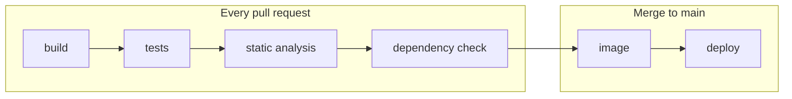

# Deployment and Operations

| Field | Value |
|---|---|
| Status | Draft |
| Owner | [TODO: name] |
| Contributors | [TODO: names] |
| Deliverable | Sprint 1 · #10 Walking Skeleton (Containerized deployment); Sprint 2 · #11 CI/CD pipeline; Final submission · #3 Deployment instructions |
| Sources | Assignment §6.7, §6.8, §8.4, §8.5, §9, §11, §12 |
| Confluence page | **10 · Walking Skeleton**, **07 · Technical Design** |
| Last updated | YYYY-MM-DD |

> **ℹ️ About this document.** How to run, configure, deploy, roll back and operate Escala, plus the runbook for its degraded modes. It is the "Deployment and operation guide" of assignment §9 and the "Deployment instructions" of §12: the teaching staff follow it to run the product, and the team follows it on demo day. The architecture behind it is in the [Technical Design](../architecture/technical-design.md); the tests that prove the runbook are in the [Test Strategy](../testing/test-strategy.md). Keep the quick start in the [repository README](../../README.md) identical to [Run locally](#run-locally).

## Environments

> **ℹ️ Guidance.** §8.4 asks for "Environment-specific configuration". List every environment, which profile it runs and who uses it. Every environment uses synthetic data only (§11); no real corps member appears in any of them.

| Environment | Where it runs | Profile | Data | Used by | URL |
|---|---|---|---|---|---|
| Local | Developer laptop, Docker Compose | `default` or `evaluation` | Synthetic seed | Developers | `http://localhost:[TODO: port]` |
| CI | GitHub Actions runners | `evaluation` [TODO: confirm] | Synthetic seed and test fixtures | Pipeline | — |
| Deployed | [TODO: host or provider] | `default` | Synthetic seed | Team, investors at the sprint reviews | [TODO: URL] |
| Evaluation | Teaching staff machine, Docker Compose, offline | `evaluation` | Synthetic seed | Teaching staff (§12) | `http://localhost:[TODO: port]` |

## Prerequisites

> **ℹ️ Guidance.** List only what a clean machine needs, with minimum versions. Aim for the evaluation environment to need nothing but Docker and Git: build every image with a multi-stage Dockerfile so no JDK or Node.js is needed on the host (§8.4 "Reproducible builds") [TODO: confirm].

- Docker [TODO: minimum version] with Docker Compose v2 [TODO: minimum version]
- Git
- Free ports: [TODO: list, e.g. web, `escala-api`, RabbitMQ management, Grafana]
- Memory and disk for the whole stack: [TODO: measured, e.g. after `docker stats`]
- Development only: JDK [TODO: Java version] (`escala-api`, `elegibilidade-worker`), Node.js [TODO: version] (`apps/web`)

## Run locally

> **ℹ️ Guidance.** One command, from a clean clone, starts everything: web, `escala-api`, `elegibilidade-worker`, both databases, RabbitMQ, the IPMA simulator, Prometheus and Grafana. Test it on a machine where it has never run, and write down what "working" looks like so the reader can check it.

```bash
git clone [TODO: repository URL] && cd [TODO: folder]
[TODO: the one command, e.g. docker compose --profile evaluation up --build]
```

It works when:

- `GET /health/ready` answers ready on `escala-api` and `elegibilidade-worker` (RF36): [TODO: URLs]
- the PWA opens at `http://localhost:[TODO: port]` and shows today's *piquete* from the seed data
- Grafana opens at `http://localhost:[TODO: port]` with the Escala dashboard

Stop: `docker compose down`. Stop and delete all local data: `docker compose down -v`.

## Configuration

> **ℹ️ Guidance.** One row per environment variable, matching `.env.example` exactly. Never write a secret value here: a secret's default is "— (secret)" and its handling is in [Secrets handling](#secrets-handling). Operational rules such as crew composition (RN04), minimum rest (RN07) and risk-based composition (RN10) are configuration too (ADR 0014): name the file that holds them [TODO: path].

| Variable | Purpose | Required | Default |
|---|---|---|---|
| [TODO: variable] | [TODO: purpose] | [TODO: Yes / No] | [TODO: default, or "— (secret)"] |

> **✏️ Example (illustrative — replace).**
> | Variable | Purpose | Required | Default |
> |---|---|---|---|
> | `ESCALA_PROFILE` | `default` or `evaluation` (see [Profiles](#profiles)) | No | `default` |
> | `IPMA_BASE_URL` | IPMA open-data base URL; the `evaluation` profile points it at `tools/ipma-sim` | No | `https://api.ipma.pt/open-data` |
> | `IPMA_DICO` | Municipality (DICO code) whose RCM is read | No | [TODO: DICO] |
> | `RISK_STALENESS_THRESHOLD` | Age of IPMA data after which the higher risk level is assumed (ADR 0013) | No | [TODO: hours] |
> | `AI_ENABLED` | Feature flag; `false` turns AI off and keeps the form flow (RF35) | No | `true` (`false` in `evaluation`) |
> | `RETRY_DELAYS` | Retry queue delays before the dead-letter queue | No | `5s,30s,2m` |
> | `ESCALA_DB_PASSWORD` | Password of `escala-db`, used by `escala-api` only | Yes | — (secret) |
> | `LLM_API_KEY` | Language-model key, worker only; needed only if ADR 0011 chooses a hosted model | No | — (secret) |

## Secrets handling

> **ℹ️ Guidance.** §8.4 asks for "Secure secret handling", and RNF07 requires no secrets in the repository, checked in CI. Explain here the deploy-time steps; the policy and threat analysis are on **09 · Security and Privacy Assessment**. §11: "Security controls must not be disabled solely to simplify the demonstration." — the `evaluation` profile keeps them on.

- **Local and evaluation:** `.env` is git-ignored; `.env.example` is committed with placeholders only. [TODO: how a reader creates `.env`, e.g. copy it and set local passwords]
- **CI/CD and deployed:** secrets live in GitHub Actions secrets [TODO: or environment secrets] and reach the containers as environment variables at deploy time; they never appear in logs.
- **Repository check:** a secret scanner runs in CI and fails the build on any finding ([TODO: tool]).
- **Separation:** each component has its own database credentials; the language-model key exists only in the worker's environment.
- **Leak:** rotate the secret at once, redeploy, and record a Jira issue labelled `risk`.

| Secret | Used by | Stored in | Rotation |
|---|---|---|---|
| [TODO: secret name, never its value] | [TODO: component] | [TODO: where] | [TODO: when and how] |

## Profiles

> **ℹ️ Guidance.** §12 asks for enough information "to inspect, deploy, execute, and evaluate the product". The `evaluation` profile uses the IPMA simulator and the AI fallback so the teaching staff can run everything offline. Say how a profile is selected and what changes; nothing else may differ between profiles.

| Profile | IPMA source | AI | Network needed | Used for |
|---|---|---|---|---|
| `default` | Live IPMA open data, polled hourly with cache | [TODO: model per ADR 0011]; form fallback when down or off | Yes | Deployed environment, sprint reviews |
| `evaluation` | `tools/ipma-sim` | Off: form and template text (RF35) | No | Teaching staff (§12), CI resilience tests, demo plan B |

- How to select a profile: [TODO: e.g. `ESCALA_PROFILE`, a Compose profile or an override file]
- How to switch the IPMA simulator mode (unavailable, delayed, incomplete, invalid): [TODO: command]

## CI/CD pipeline

> **ℹ️ Guidance.** §8.5: "The pipeline should provide rapid and visible feedback when a change introduces a defect." Keep the stages below and name the tool and the report of each. Tag every image with the commit SHA and the release tag, so any earlier version can be redeployed ([Rollback](#rollback)).



| Stage | What it does | Tool | Report |
|---|---|---|---|
| build | Compiles and packages `escala-api`, `elegibilidade-worker` and `apps/web` | [TODO: e.g. Maven / Gradle, npm] | Build log |
| tests | Unit, integration and contract tests ([Test Strategy](../testing/test-strategy.md)) | [TODO: tools] | Test and coverage reports [TODO: link] |
| static analysis | Static analysis and secret scanning (RNF07) | [TODO: tools] | [TODO: link] |
| dependency check | Known vulnerabilities in dependencies and base images | [TODO: tool] | [TODO: link] |
| image | Builds and pushes one image per component; end-to-end tests run against these images [TODO: confirm] | Docker; registry [TODO: which] | Image tags |
| deploy | Deploys the new tags to the deployed environment, then checks `/health/ready` | [TODO: how] | Deploy log with the deployed tag |

- Workflow file: `.github/workflows/[TODO: file].yml`
- Triggers: [TODO: confirm the split above between pull requests and `main`]

## Deploy

> **ℹ️ Guidance.** §8.4 asks for "Automated deployment where feasible". Describe the automatic path first, then the manual command for when the pipeline cannot run. A deploy is finished only when both services answer ready and the running tag is recorded.

1. Merge to `main`; the pipeline builds, tests and pushes the images tagged [TODO: tag scheme].
2. The deploy stage updates the deployed environment: [TODO: mechanism].
3. Database migrations run [TODO: how and when; each component migrates only its own database].
4. Smoke check: `/health/ready` on both services, then open today's piquete in the PWA.
5. Record the deployed tag: [TODO: where, e.g. the release notes or the Jira version].

Manual deploy of a given tag:

```bash
[TODO: one command, e.g. ESCALA_TAG=<tag> docker compose pull && ESCALA_TAG=<tag> docker compose up -d]
```

## Rollback

> **ℹ️ Guidance.** §8.4 asks for "A documented rollback or recovery approach", and RNF08 asks for one documented command. A rollback redeploys the previous image tag; it does not undo database migrations, so every migration must also work with the previous version [TODO: confirm]. Rehearse the rollback before each review.

```bash
[TODO: one command, e.g. ESCALA_TAG=<previous-tag> docker compose up -d]
```

- Roll back when: [TODO: e.g. `/health/ready` fails after a deploy, or a principal journey breaks]
- Find the previous tag: [TODO: where]
- After a rollback: check `/health/ready`, check the dead-letter queue is empty, and open a Jira Bug.

## Observability

> **ℹ️ Guidance.** §6.7 asks for "Structured application logs", "Health checks", "Relevant metrics", "Correlation or trace identifiers" and "Error reporting". Give the place to look for each, the two SLIs with their targets, and the alerts with their first action. Same list as **07 · Technical Design**; this document adds the commands and links.

- **Dashboard:** Grafana — [TODO: link] (RF39)
- **Logs:** structured, with one trace ID from `web` through `escala-api` and the event to `elegibilidade-worker` (RF37). Read them with `docker compose logs -f escala-api` (or any other service name) [TODO: or the log tool used in the deployed environment].
- **Health:** `/health` and `/health/ready` on both services (RF36).
- **Metrics:** exposed to Prometheus (RF38) — [TODO: main metrics].
- **Error reporting:** [TODO: how errors reach the team, e.g. error-rate panel and alerts below]
- **SLI 1:** eligibility evaluation p95 latency; target < 5 s (RNF01).
- **SLI 2:** % of requests evaluated without manual intervention; target [TODO: %].

| Alert | Condition | Notified | First action |
|---|---|---|---|
| [TODO: alert] | [TODO: condition] | [TODO: who, which channel] | [TODO: runbook row or command] |

> **✏️ Example (illustrative — replace).**
> | Alert | Condition | Notified | First action |
> |---|---|---|---|
> | Worker not ready | `elegibilidade-worker` `/health/ready` fails for [TODO: minutes] | Team channel [TODO: which] | Runbook: worker down |
> | Stale fire risk | Age of the IPMA data served > staleness threshold | Team channel | Runbook: IPMA down |
> | Dead letters | Dead-letter queue size > 0 | Team channel | Inspect the message, fix, then replay [TODO: how] |
> | Slow evaluations | Eligibility evaluation p95 ≥ 5 s for [TODO: minutes] | Team channel | Check the worker's metrics and queue depth |

## Runbook — degraded modes

> **ℹ️ Guidance.** §6.8: "The product should fail safely and communicate limitations clearly to users." Each row is a scripted demo for Sprint 2 (#13 Demonstration of at least one failure condition) and Sprint 3 (#8 Resilience and degraded-mode demonstration). *Expected behaviour* must match the degraded modes and user messages on **07 · Technical Design**; if Escala itself is down, the corps goes back to the phone.

| Scenario | How to trigger (for the demo) | Expected behaviour | Recovery |
|---|---|---|---|
| IPMA down | Switch `tools/ipma-sim` to *unavailable* [TODO: command], or `docker compose stop ipma-sim` | The last RCM value is shown with its age (RF29); beyond the staleness threshold ([TODO: hours]), the higher risk level is assumed (ADR 0013) | Restore the simulator mode or start it; after the next poll [TODO: or a forced poll], the age resets and the real level is shown again |
| AI down | Turn the AI feature flag off (RF35) [TODO: how], or make the model unreachable [TODO: how] | Form fallback: the free-text box is replaced by the unavailability form; explanations use template text per rule code | Turn the flag on or restore the model; free text is offered again, still with human confirmation |
| Worker down | `docker compose stop elegibilidade-worker` | Evaluations stay "pending"; confirmation is blocked (RF24); the API still accepts requests (RNF02) | `docker compose start elegibilidade-worker`; queued requests are processed, evaluations move from "pending" to "evaluated"; check the dead-letter queue is empty |

- The other §6.5 cases (delayed, incomplete, invalid IPMA data) are reproduced with the simulator modes; their expected behaviour is in the [Technical Design](../architecture/technical-design.md).
- Demo recordings: [TODO: links]

## Known limitations in the evaluation environment

> **ℹ️ Guidance.** §12: "Any functionality that cannot be executed in the evaluation environment must be clearly identified, explained, and demonstrated through suitable evidence." List each one with the evidence that replaces it, and keep this list identical to the one on **Sprint 3 · Deliverables**.

| Functionality | Why it cannot run there | Evidence provided |
|---|---|---|
| [TODO: functionality] | [TODO: reason] | [TODO: recording, logs, report] |

> **✏️ Example (illustrative — replace).**
> | Functionality | Why it cannot run there | Evidence provided |
> |---|---|---|
> | Live IPMA data | The `evaluation` profile runs offline with `tools/ipma-sim` | Recording of the deployed environment reading live RCM; worker logs with the IPMA source cited |
> | AI extraction with a hosted model (only if ADR 0011 chooses a hosted API) | Needs network access and an API key | The `evaluation` profile uses the form fallback; recorded demo and the AI evaluation report |
> | Automated deploy stage | Runs only in GitHub Actions, against the deployed environment | Link to a green pipeline run and its deploy log |

## Done when
- [ ] Someone who did not write it ran the *Run locally* command from a clean clone with the `evaluation` profile, then ran it again with the network disconnected once the images were built, and every check under *It works when* passed both times
- [ ] The *Configuration* table matches `.env.example`, and no secret value appears in this document or the repository
- [ ] The rollback command was rehearsed on the deployed environment and restored the previous image tag
- [ ] Each runbook scenario was triggered and recovered at least once, with the behaviour and messages on **07 · Technical Design**
- [ ] Reviewed by another team member
- [ ] Guidance and example blocks removed
- [ ] Status set to Done
