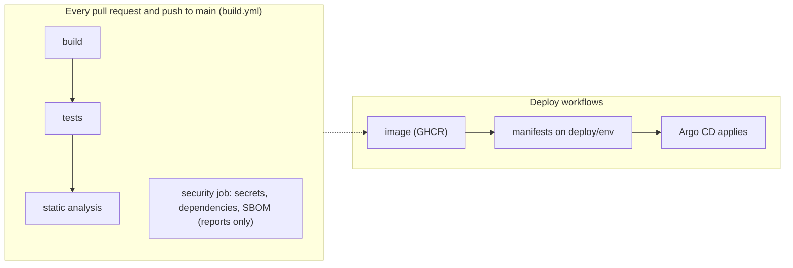

# Deployment and Operations

| Field | Value |
|---|---|
| Status | Draft |
| Owner | Diogo Costa |
| Contributors | Diogo Pereira, Pedro Costa (from the git history of `infra/`, `.github/` and the Dockerfiles) |
| Deliverable | Sprint 1 · #10 Walking Skeleton (Containerized deployment); Sprint 2 · #11 CI/CD pipeline; Final submission · #3 Deployment instructions |
| Sources | Assignment §6.7, §6.8, §8.4, §8.5, §9, §11, §12 |
| Confluence page | **10 · Walking Skeleton**, **07 · Technical Design** |
| Last updated | 2026-11-01 |

> **ℹ️ About this document.** How to run, configure, deploy, roll back and operate Escala, plus the runbook for its degraded modes. It is the "Deployment and operation guide" of assignment §9 and the "Deployment instructions" of §12: the teaching staff follow it to run the product, and the team follows it on demo day. The architecture behind it is in the [Technical Design](../architecture/technical-design.md); the tests that prove the runbook are in the [Test Strategy](../testing/test-strategy.md). Keep the quick start in the [repository README](../../README.md) identical to [Run locally](#run-locally).

## Environments

Every environment uses synthetic data only (§11); no real corps member appears in any of them. The repository has no seed data yet: a database starts empty and is filled through the API [TODO: synthetic seed data for the demo and for the teaching staff, Diogo Costa].

| Environment | Where it runs | Spring profile | Used by | URL |
|---|---|---|---|---|
| Local | Developer laptop, Docker Compose (`compose.yaml`) | `local` (set by Compose); `ide` when a service is run from the IDE | Developers | http://localhost:8000 |
| CI | GitHub Actions runners | none: nothing is deployed; the integration tests start their own PostgreSQL and RabbitMQ with Testcontainers | Pipeline | — |
| dev | Kubernetes (k3s, one VM), namespace `escala-dev` | `dev` | The team; every merge to `main` is deployed here | https://escala-dev.duckdns.org |
| qa | same cluster, namespace `escala-qa` | `qa` | Release candidates, tested before the Sprint Review (Definition of Done) | https://escala-qa.duckdns.org |
| prod | same cluster, namespace `escala-prod` | `prod` | Published releases | https://escala-prod.duckdns.org |
| Evaluation | Teaching staff machine, Docker Compose | `local`, as for Local; the Compose profile `evaluation` (IPMA simulator, AI off) does not exist yet (SCRUM-43) | Teaching staff (§12) | http://localhost:8000 |

Each environment has its own databases, RabbitMQ and secrets; nothing is shared between them. The worker is internal and has no public URL. Argo CD is at https://escala-argocd.duckdns.org and Grafana at https://escala-grafana.duckdns.org.

## Prerequisites

A clean machine needs only Docker and Git: every image is built with a multi-stage Dockerfile (JDK 21 for the Java services, Node.js 24 for the web app), so no JDK or Node.js is needed on the host.

- Docker with Docker Compose v2. Tested on 2026-11-01 with Docker 29.9.2 and Docker Compose v5.6.1 on Windows 11 [TODO: minimum Docker and Compose versions, Diogo Costa]
- Git
- Free ports (all of them can be changed in `.env`, see [Configuration](#configuration)): 8000 (web), 8080 (`escala-api`), 8081 (`elegibilidade-worker`), 5432 and 5433 (PostgreSQL), 5672 and 15672 (RabbitMQ). With the Compose profile `observability`, also 3000 (Grafana) and 3200 (Tempo), which are fixed in `compose.yaml`. On Windows, Hyper-V can reserve 5672: set `RABBITMQ_PORT=5673`.
- Memory and disk for the whole stack: [TODO: measured with `docker stats` and `docker system df`, Diogo Costa]
- Development only: JDK 21 (`escala-api`, `elegibilidade-worker`), Node.js 22.22.3+ or 24.15+ (`apps/web`, the minimum of Angular 22)

## Run locally

One command, from a clean clone, starts the web app, both backend services, both databases and RabbitMQ:

```bash
git clone https://github.com/DiogoC0307/LABDSOF_2627_1221137_1211439_1211514_1250505.git && cd LABDSOF_2627_1221137_1211439_1211514_1250505
docker compose up --build
```

The first build takes several minutes. It works when:

- `docker compose ps` shows every service as healthy
- `GET http://localhost:8080/actuator/health` and `GET http://localhost:8081/actuator/health` answer `{"status":"UP", …}` with the groups `liveness` and `readiness`; on `escala-api`, `/actuator/health/liveness` and `/actuator/health/readiness` also answer `{"status":"UP"}`. RF36 names `/health/ready`; the services expose Spring Boot Actuator's `/actuator/health` [TODO: align the endpoint name with RF36, Diogo Costa]
- `GET http://localhost:8000/api/actuator/health` answers the same through the web nginx; it is the same path as on Kubernetes (`https://escala-<env>.duckdns.org/api/actuator/health`)
- the walking skeleton works. Create a piquete and look at its slot a few seconds later:

  ```bash
  curl -X POST http://localhost:8000/api/v1/piquetes -H 'Content-Type: application/json' -d '{"dutyDate":"2026-11-01"}'   # slot status: PENDING
  curl http://localhost:8000/api/v1/piquetes                                                                               # a few seconds later: ELIGIBLE
  ```

  The PWA at http://localhost:8000 shows the same list.
- optional, Grafana at http://localhost:3000 (user `admin`) with the Compose profile `observability`, see [Observability](#observability) [TODO: Grafana dashboard for Escala (RF39) does not exist yet, Diogo Costa]

Stop: `docker compose down`. Stop and delete all local data: `docker compose down -v`.

## Configuration

The Compose variables are in `.env.example`; copy it to `.env` to change them (`.env` is git-ignored). All of them are optional: `compose.yaml` has the same defaults. A password's default is "— (secret)": the throwaway local value is in `.env.example`, and it must never be used outside your machine. The handling of real secrets is in [Secrets handling](#secrets-handling).

| Variable | Purpose | Required | Default |
|---|---|---|---|
| `ESCALA_DB_NAME`, `ESCALA_DB_USER` | Database name and user of `escala-api` | No | `escala`, `escala` |
| `ESCALA_DB_PASSWORD` | Password of the `escala-api` database | No | — (secret) |
| `ESCALA_DB_PORT` | Host port of that database | No | `5432` |
| `ELEGIBILIDADE_DB_NAME`, `ELEGIBILIDADE_DB_USER` | Database name and user of `elegibilidade-worker` | No | `elegibilidade`, `elegibilidade` |
| `ELEGIBILIDADE_DB_PASSWORD` | Password of the `elegibilidade-worker` database | No | — (secret) |
| `ELEGIBILIDADE_DB_PORT` | Host port of that database | No | `5433` |
| `RABBITMQ_USER` | RabbitMQ admin login, for people and the management UI | No | `escala` |
| `RABBITMQ_PASSWORD` | Password of the RabbitMQ admin login | No | — (secret) |
| `RABBITMQ_ESCALA_API_USER`, `RABBITMQ_WORKER_USER` | One RabbitMQ login per service (it may only touch that service's queues) | No | `escala-api`, `elegibilidade-worker` |
| `RABBITMQ_ESCALA_API_PASSWORD`, `RABBITMQ_WORKER_PASSWORD` | Passwords of those logins | No | — (secret) |
| `RABBITMQ_PORT`, `RABBITMQ_UI_PORT` | Host ports of AMQP and of the management UI | No | `5672`, `15672` |
| `WEB_PORT`, `ESCALA_API_PORT`, `ELEGIBILIDADE_WORKER_PORT` | Host ports of the web app and of the two services | No | `8000`, `8080`, `8081` |
| `OTEL_JAVAAGENT_ENABLED` | Switches the OpenTelemetry Java agent on (profile `observability`) | No | `false` |
| `JAVA_TOOL_OPTIONS` | Must carry `-javaagent:/otel/opentelemetry-javaagent.jar` to load the agent; empty otherwise | No | empty |
| `GRAFANA_PASSWORD` | Password of the Grafana `admin` user (profile `observability`) | No | — (secret) |

Compose and the Kubernetes ConfigMaps (`infra/k8s/<env>/<service>/configmap.yaml`) configure the services with Spring Boot environment variables:

| Variable | Purpose | Compose | Kubernetes |
|---|---|---|---|
| `SPRING_PROFILES_ACTIVE` | Spring profile | `local` | `dev`, `qa` or `prod` |
| `LOGGING_LEVEL_ROOT` | Log level | `INFO` | `DEBUG` in dev, `INFO` in qa, `WARN` in prod |
| `SPRING_DATASOURCE_URL` | JDBC URL of the service's own database | set | set in the ConfigMap |
| `SPRING_DATASOURCE_USERNAME`, `SPRING_DATASOURCE_PASSWORD` | Database login | from `.env` | from the Secret `db-escala-api` or `db-elegibilidade` |
| `SPRING_RABBITMQ_HOST`, `SPRING_RABBITMQ_PORT` | Broker address | `rabbitmq`, `5672` | `rabbitmq` (host) |
| `SPRING_RABBITMQ_USERNAME`, `SPRING_RABBITMQ_PASSWORD` | The service's own RabbitMQ login | from `.env` | from the Secret `rabbitmq-escala-api` or `rabbitmq-elegibilidade-worker` |
| `SPRING_RABBITMQ_DYNAMIC` | `false`: the service does not declare exchanges or queues; they come from `infra/rabbitmq/definitions.json` | `false` | — |
| `OTEL_*`, `LOGGING_PATTERN_LEVEL` | OpenTelemetry agent settings and the `[trace_id,span_id]` log pattern | see `compose.yaml` | see the ConfigMaps |

The database schema is created and updated by Hibernate when a service starts (`spring.jpa.hibernate.ddl-auto=update`); each service touches only its own database. Operational rules such as crew composition (RN04), minimum rest (RN07) and risk-based composition (RN10) are configuration (ADR 0014) [TODO: path of the file that holds them; it does not exist yet, Diogo Costa].

## Secrets handling

Policy and threat analysis are on **09 · Security and Privacy Assessment**; this section is the deploy-time part.

- **Local and evaluation:** `.env` is git-ignored; `.env.example` is committed with throwaway local values only. Copy it to `.env` if you need to change a value.
- **Kubernetes:** passwords are random and different per environment. Git holds only **encrypted** Sealed Secrets files (`sealed-secret*.yaml`), created by `infra/scripts/seal-secrets` (`.sh` and `.ps1`); the Sealed Secrets controller in the cluster turns them into Kubernetes Secrets, which reach the pods as environment variables. They are not in a `.env` file on the VM, not in Docker secrets and not in the images.
- **GitHub Actions:** the SonarQube analysis uses the repository secrets `SONAR_TOKEN` and `SONAR_HOST_URL`; pushing images to GHCR uses the workflow's `GITHUB_TOKEN`. The pipeline holds no cluster credentials (Argo CD pulls from Git).
- **Repository check:** the `security` job of `build.yml` runs gitleaks over the history. It only reports for now and does not fail the build [TODO: make it fail the build on a real finding (RNF07, SCRUM-20), Diogo Costa].
- **Separation:** each component has its own database login and its own RabbitMQ login. [TODO: how the Claude Code CLI of the worker is authenticated, once ADR 0016 is accepted, Diogo Costa]
- **Encryption at rest:** k3s does not encrypt Secrets at rest by default; the procedure to enable it is in the [README](../../README.md#where-the-passwords-are-stored). [TODO: has it been enabled on the VM, Diogo Costa]
- **Leak:** rotate the secret at once, redeploy, and record a Jira issue labelled `risk`.

| Secret | Used by | Stored in | Rotation |
|---|---|---|---|
| `db-escala-api` | `escala-api` and its PostgreSQL | Sealed Secret in git; Secret in the environment's namespace | `seal-secrets -Force`, then `ALTER USER … PASSWORD …` in PostgreSQL ([README](../../README.md#where-the-passwords-are-stored)) |
| `db-elegibilidade` | `elegibilidade-worker` and its PostgreSQL | same | same |
| `rabbitmq-escala-api`, `rabbitmq-elegibilidade-worker` | the matching service and the broker | same | [TODO: when and how, Diogo Costa] |
| `rabbitmq-credentials` | RabbitMQ admin login | same | [TODO: when and how, Diogo Costa] |
| `grafana-admin` | Grafana `admin` | same, in the namespace `observability` | [TODO: when and how, Diogo Costa] |
| `SONAR_TOKEN`, `SONAR_HOST_URL` | `build.yml` | GitHub Actions secrets | [TODO: when and how, Diogo Costa] |

## Profiles

Spring profiles select the settings of a service:

| Profile | Used when | Source |
|---|---|---|
| `ide` | A service is started from the IDE or with `./mvnw spring-boot:run` and no other profile is active | `application-ide.properties` in each service: localhost defaults and `spring.rabbitmq.dynamic=false` |
| `local` | Docker Compose | `SPRING_PROFILES_ACTIVE` in `compose.yaml` |
| `dev`, `qa`, `prod` | Kubernetes | the ConfigMap of each service |

Compose has one profile, `observability`: it adds Tempo and Grafana. To try tracing on your machine:

```powershell
$env:JAVA_TOOL_OPTIONS = "-javaagent:/otel/opentelemetry-javaagent.jar"
$env:OTEL_JAVAAGENT_ENABLED = "true"
docker compose --profile observability up --build -d
```

The product-level profiles of §12 are not built yet. Selecting a profile and switching the IPMA simulator mode will be documented when they exist:

| Profile | IPMA source | AI | Network needed | Used for |
|---|---|---|---|---|
| `default` | Live IPMA open data, polled hourly with cache (ADR 0010) | [TODO: model per ADR 0016, once it is accepted, Diogo Pereira]; form fallback when down or off | Yes | Deployed environment, sprint reviews |
| `evaluation` | `tools/ipma-sim` (SCRUM-43) | Off: form and template text (RF35) | No | Teaching staff (§12), CI resilience tests, demo plan B |

- How to select a profile: [TODO: a Compose profile or an override file, once SCRUM-43 is done, Diogo Costa]
- How to switch the IPMA simulator mode (unavailable, delayed, incomplete, invalid): [TODO: command, once SCRUM-43 is done, Diogo Costa]

## CI/CD pipeline



| Stage | What it does | Tool | Report |
|---|---|---|---|
| build | Compiles and packages `escala-api`, `elegibilidade-worker` and `apps/web` | Maven wrapper (Java 21); npm (Node.js 24) | Build log |
| tests | Unit and integration tests ([Test Strategy](../testing/test-strategy.md)) | JUnit with Testcontainers, JaCoCo; Vitest with coverage | Artefacts `escala-api-reports`, `elegibilidade-worker-reports`, `web-reports` on each run |
| static analysis | Code quality and coverage | SonarQube | SonarQube [TODO: links to the SonarQube projects, once the project-key problem in the [workflows README](../../.github/workflows/README.md#sonarqube-configuration) is fixed, Diogo Costa] |
| dependency check and secret scan | `npm audit`, OSV-Scanner on the lockfile and on the Maven SBOMs, gitleaks; CycloneDX SBOMs; reports only | `security` job of `build.yml` | Job summary and artefacts `security-reports` and `sbom` |
| image | Builds and pushes one image per component to GHCR, tagged with the commit SHA | `build-images.yml` (Docker Buildx) | Image tags in GHCR |
| deploy | Renders the manifests of the environment and publishes them to the branch `deploy/<env>`, which Argo CD applies | `deploy.yml`, Kustomize, Argo CD | The commit on `deploy/<env>`: `deploy(<env>): <tag> (source <sha>)` |

- Workflow files and their triggers: [`.github/workflows/README.md`](../../.github/workflows/README.md)
- The end-to-end tests do not run in the pipeline yet [TODO: end-to-end tests in the pipeline, Diogo Sousa, see the Test Strategy].

## Deploy

The automatic path:

1. Merge to `main`. The workflow *Deploy DEV* builds the three images and tags them with the commit SHA (and `latest`). A `release/X.Y.Z` branch deploys to qa with the tag `X.Y.Z-rc.<run number>`; publishing a GitHub Release `vX.Y.Z` deploys to prod with the images that qa tested, retagged `X.Y.Z`.
2. The pipeline renders `infra/k8s/<env>` with the new tag and pushes `manifests.yaml` to the branch `deploy/<env>`. Argo CD, in the cluster, watches that branch and applies it. dev and qa sync by themselves; prod waits for a click on **Sync** in Argo CD (and for the approval of the GitHub Environment `production`, if enabled).
3. Database changes are applied by each service when it starts (Hibernate `ddl-auto=update`); each service migrates only its own database. Hibernate creates tables and columns, but it never changes a constraint that already exists: when an enum gets new values, a database that already exists keeps rejecting them. This is what broke `POST /api/v1/piquetes` on dev on 2026-11-01 (see the [Runbook](#runbook--degraded-modes)). There is no migration tool yet [TODO: migration tool and the rule that every migration works with the previous version, Diogo Costa].
4. Smoke check: `https://escala-<env>.duckdns.org/api/actuator/health` returns `{"status":"UP"}`, then create a piquete and see its slot go from `PENDING` to `ELIGIBLE`.
5. The deployed tag is recorded in the commit message on the branch `deploy/<env>`; `git log deploy/prod` is the history of everything deployed to production.

There is no one-command manual deploy of an arbitrary tag. The workflows can be started by hand only for dev (*Deploy DEV* has `workflow_dispatch`); to put an older version back, use [Rollback](#rollback). The release steps (cutting a release, fixing what qa finds, hotfixes) are in the [README](../../README.md#releasing-git-flow).

## Rollback

A rollback redeploys a previous version; it does not undo database changes, because the schema is updated by Hibernate and not by reversible migrations.

- **prod:** in Argo CD open `escala-prod`, History and rollback, and pick the previous revision. Old images stay in the registry. Kubernetes keeps no old ReplicaSets (`revisionHistoryLimit: 0` on every Deployment), so `kubectl rollout undo` is not available.
- **dev:** `git revert` the merge commit in a new pull request; the merge to `main` redeploys dev.
- **qa:** push the revert or the fix to the `release/X.Y.Z` branch; qa redeploys. Argo CD can also roll qa back, but `escala-qa` has auto-sync with `selfHeal` (`infra/argocd/apps.yaml`; `escala-prod` has none), so turn them off first and on again afterwards.
- Roll back when: `/api/actuator/health` fails after a deploy, or the walking skeleton check in [Deploy](#deploy) fails.
- After a rollback: check the health endpoint, check the dead-letter queue is empty, and open a Jira Bug.
- **Rehearsed on qa on 2026-11-01** (Diogo Pereira, in Argo CD): auto-sync and `selfHeal` off, History and rollback to the previous revision (`0.2.0-rc.2`), then back to `0.3.0-rc.3` with auto-sync and `selfHeal` on again. Rolling back took a little over a minute and less than a minute and a half (timed by hand). While rolled back, `/api/actuator/health` answered `200`, `GET /api/v1/piquetes` answered `404` (the nginx of the old version) and the PWA bundle was not the one of `0.3.0`. After rolling forward, `GET /api/v1/piquetes` answered `200` and a new piquete went from `PENDING` to `ELIGIBLE` in 3 seconds. The image tags of the pods were not captured.
- Not rehearsed on prod. [TODO: one documented command for a rollback (RNF08); the rehearsal needed several steps in Argo CD, Diogo Costa]

## Observability

- **Dashboard:** Grafana at https://escala-grafana.duckdns.org shows traces and logs for all environments (log in as `admin`; the password is in the Secret `grafana-admin`). [TODO: an Escala dashboard (RF39), Diogo Costa]
- **Traces:** the OpenTelemetry Java agent in both Java images records HTTP requests, database queries and RabbitMQ publish and consume, and carries the trace across RabbitMQ from one service to the other. Tempo keeps them 7 days. In Grafana: Explore, Tempo, Search by service name (`escala-api` or `elegibilidade-worker`).
- **Logs:** Grafana Alloy collects the logs of every pod in the `escala-*` namespaces and sends them to Loki, which keeps them 90 days. Log lines carry `[trace_id,span_id]`, so Grafana jumps from a log line to its trace. With Docker Compose, read them with `docker compose logs -f escala-api` (or any other service name); they rotate at 10 Mi and 5 files per container.
- **Health:** `/actuator/health` on both services, with the groups `liveness` and `readiness`; Kubernetes probes use it.
- **Metrics:** none are exposed yet: only the `health` endpoint is exposed (`management.endpoints.web.exposure.include=health`) [TODO: Prometheus metrics (RF38), Diogo Costa].
- **Error reporting:** [TODO: how errors reach the team, e.g. an error-rate panel and alerts, Diogo Costa]
- **SLI 1:** eligibility evaluation p95 latency; target < 5 s (RNF01). It is not measured yet.
- **SLI 2:** % of requests evaluated without manual intervention; target [TODO: %, Diogo Pereira].

| Alert | Condition | Notified | First action |
|---|---|---|---|
| [TODO: define the alerts, their conditions, who is notified and the first action of each, Diogo Costa] | — | — | — |

No alerts exist yet. They should at least cover: worker not ready, stale fire risk, dead letters and slow evaluations (see the runbook below).

## Runbook — degraded modes

> **ℹ️ Guidance.** §6.8: "The product should fail safely and communicate limitations clearly to users." Each row is a scripted demo for Sprint 2 (#13 Demonstration of at least one failure condition) and Sprint 3 (#8 Resilience and degraded-mode demonstration). *Expected behaviour* must match the degraded modes and user messages on **07 · Technical Design**; if Escala itself is down, the corps goes back to the phone.

| Scenario | How to trigger (for the demo) | Expected behaviour | Recovery |
|---|---|---|---|
| IPMA down | [TODO: switch `tools/ipma-sim` to *unavailable* (SCRUM-43), Diogo Costa] | The last RCM value is shown with its age (RF29); beyond the staleness threshold, the higher risk level is assumed (ADR 0013). Planned, not built yet | Planned, after SCRUM-43 |
| AI down | [TODO: the AI feature flag (ADR 0011) does not exist yet, Diogo Costa] | Form fallback: the free-text box is replaced by the unavailability form (RF35). Planned, not built yet | Planned, after the flag exists |
| Worker down | `docker compose stop elegibilidade-worker` | Tested on Compose on 2026-11-01: the API keeps accepting requests (`POST /api/v1/piquetes` answers `201`), the slot stays `PENDING` and the request waits in the queue `worker.avaliacao-pedida` | `docker compose start elegibilidade-worker`: the waiting request is processed and the slot became `ELIGIBLE` within 9 seconds in that test. Check the dead-letter queue is empty |

- The other §6.5 cases (delayed, incomplete, invalid IPMA data) will be reproduced with the simulator modes once SCRUM-43 is done.
- The "worker down" scenario was tried on Compose only, not on Kubernetes.
- **Seen on dev, 2026-11-01: `POST /api/v1/piquetes` answers `500` while `GET` and the health check answer `200`.** The log of `escala-api` (Grafana, Loki) showed `new row for relation "slot" violates check constraint "slot_status_check"`: the dev database was created when a slot status had three values (`OPEN`, `PROPOSED`, `FILLED`) and `ddl-auto=update` did not change the constraint when `PENDING` and `ELIGIBLE` were added. Fixed in Argo CD, not in Git: delete the PVC `data-pg-escala-api-0` and the pod `pg-escala-api-0` of `escala-dev` (the data of dev was test data only), then delete the pod of `escala-api` so it creates the tables again. Afterwards `POST` answered `201` and the slot went from `PENDING` to `ELIGIBLE` in 3 seconds. qa and prod were not affected: version `0.2.0` had no `slot` table. The missing migration tool is the TODO in [Deploy](#deploy).
- Demo recordings: [TODO: links, Diogo Pereira]

## Known limitations in the evaluation environment

> **ℹ️ Guidance.** §12: "Any functionality that cannot be executed in the evaluation environment must be clearly identified, explained, and demonstrated through suitable evidence." List each one with the evidence that replaces it, and keep this list identical to the one on **Sprint 3 · Deliverables**.

| Functionality | Why it cannot run there | Evidence provided |
|---|---|---|
| [TODO: list what cannot run in the evaluation environment and the evidence that replaces it, Diogo Costa] | — | — |

## Done when
- [ ] Someone who did not write it ran the *Run locally* command from a clean clone with the `evaluation` profile, then ran it again with the network disconnected once the images were built, and every check under *It works when* passed both times
- [ ] The *Configuration* table matches `.env.example`, and no secret value appears in this document or the repository
- [x] The rollback was rehearsed on a deployed environment (qa, 2026-11-01) and restored the previous version; prod was not rehearsed
- [ ] Each runbook scenario was triggered and recovered at least once, with the behaviour and messages on **07 · Technical Design**
- [ ] Reviewed by another team member
- [ ] Guidance and example blocks removed
- [ ] Status set to Done
