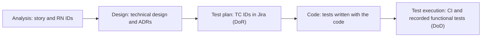

# Test Strategy

| Field | Value |
|---|---|
| Status | Draft |
| Owner | Diogo Sousa |
| Contributors | Diogo Pereira (from the git history of this file) |
| Deliverable | Sprint 2 · #10 Automated unit, integration, and relevant end-to-end tests; Final submission · #7 Test and quality evidence |
| Sources | Assignment §8.3, §9, §11, §12; Deck (Analysis → Design → Test plan → Code → Test execution; Definition of Ready; Definition of Done) |
| Confluence page | — (linked from **Definition of Done (DoD)** and **07 · Technical Design**) |
| Last updated | 2026-11-01 |

> **ℹ️ About this document.** How Escala is tested: which risks drive the tests, which test types run where, how test cases are named and traced, and where the evidence lives. It is the "Test strategy and evidence" of assignment §9 and answers §8.3; developers, reviewers and the teaching staff read it next to the [Technical Design](../architecture/technical-design.md) and [Deployment and Operations](../operations/deployment-and-operations.md).

## Approach

> **ℹ️ Guidance.** Assignment §8.3: "The test strategy should be proportional to the system's risks and architecture." List the top 5–7 product and technical risks, most severe first, and name the test type that covers each; a risk with no test goes to [What remains untested and why](#what-remains-untested-and-why). Test cases are planned before code, following the deck's *Analysis → Design → Test plan → Code → Test execution*; the **Definition of Ready (DoR)** already requires `TC-` IDs.

| # | Risk | Test type(s) that cover it | Requirement / rule |
|---|---|---|---|
| 1 | [TODO: risk] | [TODO: test type] | [TODO: RN / RF / RNF ID] |

> **✏️ Example (illustrative — replace).**
> | # | Risk | Test type(s) that cover it | Requirement / rule |
> |---|---|---|---|
> | 1 | Someone with an expired TAS is confirmed on a slot | Unit (eligibility rules), end-to-end (confirmation blocked) | RN02, RF24, RNF04 |
> | 2 | A duplicate event creates a second evaluation or assignment | Integration (real RabbitMQ and PostgreSQL), contract | RNF05 |
> | 3 | IPMA is down or returns invalid data and the risk shown is wrong | Resilience (IPMA simulator modes), unit (response parser) | RF25, RF29, RNF03 |
> | 4 | `escala-api` and `elegibilidade-worker` disagree on an event schema | Contract | `contracts/events/` |
> | 5 | The AI extraction reads the wrong dates and the user does not notice | AI evaluation, end-to-end (editable fields, "read automatically" label) | RF31–RF33 |

## Test types

> **ℹ️ Guidance.** One row per §8.3 test type; in *What it covers*, name the risk or requirement it protects, because §8.3 asks teams to "justify the types of tests selected". Tools marked "e.g." are suggestions: confirm or replace them. If you drop a type, move it to *What remains untested and why* with the reason.

| Type | What it covers | Tool | CI stage | Owner |
|---|---|---|---|---|
| Unit | Eligibility rules RN01–RN10 (positive, negative, boundary); date and hour calculations; IPMA response parsing; extraction post-processing | JUnit Jupiter (`escala-api`, `elegibilidade-worker`); Vitest with jsdom (`apps/web`, run with `ng test`) | tests | [TODO: name, Diogo Sousa] |
| Integration | Each service with its real PostgreSQL and RabbitMQ: transactional outbox, idempotency key, retries 5 s / 30 s / 2 min then DLQ, free text deleted after confirmation (RNF09) | Testcontainers (PostgreSQL 17 and RabbitMQ 4.0 containers), Awaitility | tests | [TODO: name, Diogo Sousa] |
| Contract | API ↔ worker event schemas (`AvaliacaoPedida`, `AvaliacaoConcluida`, `ExtracaoPedida`, `ExtracaoConcluida`, `RiscoAtualizado`) against `contracts/events/`; REST endpoints against `contracts/openapi.yaml` | [TODO: schema validator used in both test suites] | tests | [TODO: name] |
| End-to-end | Principal journey J1 on the Docker Compose stack: declared unavailability → gap → eligible candidates → confirmation; confirmation blocked without a valid evaluation (RF24) | [TODO: browser test tool] | image (runs against the built images) [TODO: confirm] | [TODO: name] |
| Security | Static analysis; dependency check; secret scanning (RNF07); role checks on every endpoint, e.g. nobody confirms their own application | SonarQube (static analysis); `npm audit` and OSV-Scanner (dependencies); gitleaks (secrets). The last three are in the `security` job of `build.yml`, which only reports for now | static analysis; `security` job | [TODO: name, Diogo Sousa] |
| Performance | Eligibility evaluation p95 < 5 s (RNF01); unavailability accepted with 202 in < 500 ms (RNF02) | [TODO: load-test tool] | [TODO: scheduled, or manual before the Sprint 3 review] | [TODO: name] |
| Resilience | IPMA simulator modes (unavailable, delayed, incomplete, invalid); worker stopped → evaluations "pending", confirmation blocked; AI off → form fallback | IPMA simulator (`tools/ipma-sim`), Docker Compose | [TODO: stage, e.g. nightly] | [TODO: name] |
| AI evaluation | Extraction on the 60-case synthetic dataset, compared with the non-AI baseline [TODO: Java baseline — decision pending (SCRUM-54)], against the acceptance criteria on **06 · Responsible AI Opportunity Assessment** (start/end exact ≥ 95%, type ≥ 90%, adverse handled 100%, p95 latency < 4 s) | Dataset runner [TODO: path] | [TODO: when the prompt, model or dataset changes] | [TODO: name] |

### Coverage target

At least 70% of the lines of new code, measured with JaCoCo (Java services) and Vitest with lcov (`apps/web`) and reported by SonarQube. This is the quality bar of the Definition of Done. [TODO: the 70% threshold is not set in the SonarQube quality gate yet (an open item on the Definition of Done page), Diogo Sousa]

### Tests that exist today

| Component | Test class | Tests | What it checks |
|---|---|---|---|
| `escala-api` | `EscalaApiApplicationTests` | 1 | The application starts with a PostgreSQL and a RabbitMQ container |
| `escala-api` | `CreatePiqueteIT` | 2 | Creating a piquete through the API (integration, Testcontainers) |
| `elegibilidade-worker` | `ElegibilidadeWorkerApplicationTests` | 1 | The application starts with a PostgreSQL and a RabbitMQ container |
| `elegibilidade-worker` | `AvaliacaoPedidaIT` | 1 | An `AvaliacaoPedida` event sent through RabbitMQ is answered with an `AvaliacaoConcluida` that is `ELIGIBLE` and carries the same trace ID |
| `apps/web` | `app.spec.ts` | 11 | The piquete list, creating a piquete and polling until the slot is `ELIGIBLE`, error and offline states, and the install prompt |

Counts are from `./mvnw verify` and `npm run test:ci` on 2026-11-01. The Java tests do not carry a `TC-` ID yet.

## Test case convention

- **ID:** `TC-SCRUM-<key>-nn`, e.g. `TC-SCRUM-46-01`, `TC-SCRUM-46-02`.
- **Format:** Given/When/Then, written in the Jira story's acceptance criteria before coding (DoR: "a test plan and test cases are outlined").
- **Coverage:** every business rule (`RN`) gets at least one positive, one negative and one **boundary** test case.
- **Traceability:** the TC IDs are linked in Jira; each automated test carries its TC ID in its name, so a CI report can be traced back to the story. In `apps/web` the ID starts the test name, e.g. `it('TC-SCRUM-46-01 lists today's date, slot and evaluation status', …)`; for the Java tests the form is `@DisplayName("TC-SCRUM-<key>-nn …")`.
- **Manual functional tests** (DoD: "functional tests performed and recorded"): record TC ID, date, version, who and result [TODO: where, e.g. a comment on the Jira story].

Test cases with a `TC-` ID today, both in `apps/web/src/app/app.spec.ts` (story SCRUM-46, the installable phone PWA):

- `TC-SCRUM-46-01`: lists today's date, slot and evaluation status.
- `TC-SCRUM-46-02`: offers install when the browser fires `beforeinstallprompt`.

## Boundary cases catalogue

> **ℹ️ Guidance.** Boundaries are where eligibility bugs hide. Keep one row per boundary and add one whenever a rule is refined. When the expected behaviour depends on a rule that is not confirmed yet, write `[TODO: …]` naming the rule (e.g. `[TODO: RN07 — internal regulation still to obtain]`); never guess the rule in a test.

| Boundary case | Rule / requirement | Expected behaviour | Test case(s) |
|---|---|---|---|
| Certification expiring on the slot date | RN02 | [TODO: eligible or ineligible — decide how RN02 treats the expiry day] | `TC-SCRUM-999-02` |
| Rest period ending exactly at the next start | RN07 | [TODO: internal regulation still to obtain; the minimum rest is configurable] | [TODO: TC ID] |
| Duty period crossing midnight | RN05, RN09 | Overlap is checked on start/end instants, not calendar dates; hours count on [TODO: which day] | [TODO: TC ID] |
| Daylight-saving change | RN07, RN09, ADR 0012 (UTC instants with explicit time zone) | A slot spanning the clock change is one hour longer or shorter than its wall-clock times suggest; rest and hours use real duration [TODO: confirm] | [TODO: TC ID] |
| Duplicate event delivered twice | RNF05 | The idempotency key makes the second delivery a no-op: one evaluation, one assignment | [TODO: TC ID] |
| [TODO: next boundary] | [TODO: rule] | [TODO: behaviour] | [TODO: TC ID] |

## Test data

> **ℹ️ Guidance.** Assignment §11: "Real personal or sensitive data should not be used when synthetic or anonymized data is sufficient." For Escala synthetic data is always sufficient, so every test uses it. Say where each data set lives and how it is produced; never copy real rosters, certifications or messages, even anonymised.

- **Seed data:** placeholder members (Member A, Member B…), synthetic certifications and licences, one fictional corps. Path: [TODO: path].
- **IPMA fixtures:** simulator responses for RCM levels 1–5 and for the four §6.5 cases (unavailable, delayed, incomplete, invalid). Path: `tools/ipma-sim` [TODO: fixture folder].
- **AI evaluation dataset:** 60 team-written cases (35 normal / 15 difficult / 10 adverse), JSONL, path [TODO: path]; origin and limitations on **06 · Responsible AI Opportunity Assessment**.
- **Clock:** tests use a fixed clock [TODO: how], so boundary cases do not depend on the day the pipeline runs.

> **✏️ Example (illustrative — replace).** One synthetic seed member: `{"code": "M-A", "name": "Member A", "roster": "ACTIVE", "certifications": [{"type": "TAS", "expiresOn": "YYYY-MM-DD"}], "licenceClass": "[TODO: class]"}`. No contacts, no date of birth.

## Evidence

> **ℹ️ Guidance.** Assignment §12 asks for "Test and quality evidence". Every row must end in a link a reviewer can open, not "ask us". Attach the final reports to the release so they outlive CI artefact retention [TODO: check the retention period].

| Evidence | Produced by | Where to find it |
|---|---|---|
| Unit and integration test reports | CI `tests` stage | GitHub Actions run → artefacts `escala-api-reports`, `elegibilidade-worker-reports` (Surefire) and `web-reports` |
| Coverage report | CI `tests` stage | Same artefacts (JaCoCo HTML for the Java services, `coverage/` for `apps/web`) and SonarQube [TODO: link to the SonarQube projects, Diogo Sousa] |
| Static analysis and dependency check reports | SonarQube step and `security` job of `build.yml` | SonarQube [TODO: link, Diogo Sousa]; job summary and artefacts `security-reports` and `sbom` of the run |
| End-to-end report (screenshots on failure) | CI `image` stage [TODO: confirm] | [TODO: link] |
| Recorded manual functional tests | Team members | [TODO: where, e.g. Jira story comments] |
| Performance results | [TODO: stage or person] | [TODO: link] |
| Resilience and degraded-mode demonstration | Runbook in [Deployment and Operations](../operations/deployment-and-operations.md) | [TODO: recording or CI run link] |
| AI evaluation results | Dataset runner | **06 · Responsible AI Opportunity Assessment** [TODO: link to the report] |

## What remains untested and why

> **ℹ️ Guidance.** Required by §8.3: "Teams must justify the types of tests selected and identify important areas that remain untested." Name each untested area, why it is untested, what could go wrong and what reduces the risk. An honest gap is worth more than a claimed coverage number; review this list at every sprint review.

| Area | Why it is untested | What could go wrong | Mitigation / when |
|---|---|---|---|
| [TODO: area] | [TODO: reason] | [TODO: consequence] | [TODO: mitigation or planned sprint] |

> **✏️ Example (illustrative — replace).**
> | Area | Why it is untested | What could go wrong | Mitigation / when |
> |---|---|---|---|
> | Real authentication | Mocked in the MVP (§6.6 footnote); roles are tested, login is not | Integration problems with a future identity provider | [TODO: when real authentication is planned] |
> | Live IPMA API failures | The live API cannot be forced to fail; failure modes are reproduced with the simulator only | A real response differs from the simulator's format | One check against the live endpoints [TODO: when]; unknown formats are treated as invalid data |
> | PWA on many phone models | No device lab | Layout or offline problems on some phones | Manual check on [TODO: number] team phones; accessibility review in Sprint 3 |

## Done when
- [ ] Every top risk in *Approach* maps to at least one test type, or is listed under *What remains untested and why*
- [ ] Every business rule (RN) has positive, negative and boundary test cases, with `TC-` IDs linked in Jira
- [ ] Every link under *Evidence* opens the latest green run or report
- [ ] *What remains untested and why* is filled and reviewed at the last sprint review
- [ ] Reviewed by another team member
- [ ] Guidance and example blocks removed
- [ ] Status set to Done
