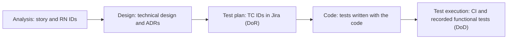

# Test Strategy

| Field | Value |
|---|---|
| Status | In review |
| Owner | Diogo Sousa |
| Contributors | Diogo Pereira |
| Deliverable | Sprint 2 · #10 Automated unit, integration, and relevant end-to-end tests; Final submission · #7 Test and quality evidence |
| Sources | Assignment §8.3, §9, §11, §12; Deck (Analysis -> Design -> Test plan -> Code -> Test execution, Definition of Ready, Definition of Done) |
| Confluence page | **Definition of Done (DoD)** and **07 · Technical Design** |

## About this document

How Escala is tested: which risks drive the tests, which test types run where, how test cases are named and traced, and where the evidence lives.

## Approach

Test cases are planned before code, following the deck's *Analysis -> Design -> Test plan -> Code -> Test execution*. 

## Risks

These are the top risks, most severe first (also covered in [What remains untested and why](#what-remains-untested-and-why) section).

| # | Risk | Test type(s) that cover it | Requirement/Rule |
|---|---|---|---|
| 1 | Someone who is not qualified, not available or not rested is placed in a slot | Unit (eligibility rules, with clock and date boundaries), end-to-end | RN01–RN08, RN12–RN14, RF21 |
| 2 | An assignment, swap or cover is applied without a valid evaluation. Worker down, evaluation failed or out of date | Integration (evaluation states), resilience (worker stopped) | RF24, RNF04 |
| 3 | A message is lost, or a duplicate is applied twice | Integration (real RabbitMQ and PostgreSQL) | RNF05, §6.3 |
| 4 | Personal data reaches someone who should not see it: another member, the logs or the AI provider | Integration (role access, log leaks), security | RF40, RNF07, RNF09, T-07, T-08, T-12 |
| 5 | The AI reads the wrong dates and the member does not notice | AI evaluation, unit (schema and date guards), end-to-end (confirm step) | RF31–RF33, RF35 |
| 6 | `escala-api`, `elegibilidade-worker` and `apps/web` disagree on an event or a REST response | Contract | `contracts/events/`, `contracts/openapi.yaml` |
| 7 | IPMA is down or its data is unusable, and the risk shown is wrong | Unit (response parser), resilience (simulator modes) | RF25, RF29, RNF03, ADR 0013 |

## Test types

The eligibility rules are deterministic (ADR 0007) and full of date boundaries, so most cases are cheap unit tests. The two services share no database and meet only at RabbitMQ, where mocks would hide the real failures (retries, duplicates, restarts), so integration tests run against real containers, and contract tests guard the messages between them. 

| Type | What it covers | Risks | Tool | When it runs | State and owner |
|---|---|---|---|---|---|
| Unit | Eligibility rules RN01–RN08 and RN11–RN14 (positive, negative, boundary); date and time calculations; extraction post-processing; IPMA response parsing | 1, 5, 7 | JUnit Jupiter (`escala-api`, `elegibilidade-worker`); Vitest with jsdom (`apps/web`, run with `ng test`) | `build.yml`, every pull request to and push on `main` | Extraction and web tests exist. The rules are not implemented yet (the worker answers `SEMPRE_ELEGIVEL`), so their tests come with SCRUM-65, SCRUM-69, SCRUM-160 and SCRUM-161. Owner: the developer of each story |
| Integration | Each service with its real PostgreSQL and RabbitMQ: transactional outbox, idempotency key, retries 5s/30s/2 min then DLQ, evaluation states, migrations, role access, log leaks; free text deleted after confirmation (RNF09, planned in SCRUM-75) | 2, 3, 4 | Testcontainers (PostgreSQL 17 and RabbitMQ 4.0 containers), Awaitility | `build.yml` | Exists. Owner: the developer of each story |
| Contract | Event schemas (`AvaliacaoPedida`, `AvaliacaoConcluida`, `ExtracaoPedida`, `ExtracaoConcluida`, `RiscoAtualizado`) against `contracts/events/`; REST responses against `contracts/openapi.yaml` | 6 | Chosen in SCRUM-96 | `build.yml` | Not yet: SCRUM-96, in progress |
| End-to-end | The principal journey on the Docker Compose stack: the supervisor publishes a week, a member sees their shift and says they can't come, a free and qualified colleague accepts the cover, the slot shows the colleague | 1 | Browser test, e.g. Playwright (SCRUM-100) | `build.yml` | Not yet: SCRUM-100 |
| Security | Static analysis; dependency check; secret scanning (RNF07); role checks on the endpoints that exist (`RoleAccessIT`, `MemberAccessIT`, `UnavailabilityIT`) | 4 | SonarQube; `npm audit` and OSV-Scanner; gitleaks; JUnit | `build.yml`; the `security` job only reports and does not fail the build yet | Exists |
| Performance | Unavailability by form saved in < 500 ms (RNF02, TC-SCRUM-64-03); evaluation p95 < 5 s (RNF01) | 2 | JUnit in `UnavailabilityIT` (p95 of 30 saves) | RNF02 in `build.yml` | RNF02 exists. RNF01 is not tested |
| Resilience | Worker stopped: swaps and covers stay pending and nothing is applied (RNF04); IPMA unavailable, delayed, incomplete or invalid; AI off: the form still works (RF35) | 2, 5, 7 | Docker Compose; IPMA simulator (`tools/ipma-sim`) | By hand, from the runbook in [Deployment and Operations](../operations/deployment-and-operations.md) | Retries, the DLQ and a restart of the service in the middle are automated (SCRUM-95). The worker demo is SCRUM-98, the form fallback SCRUM-89, the IPMA tests SCRUM-76 |
| AI evaluation | Extraction on the 60-case synthetic dataset, compared with the non-AI baseline `RuleBasedExtractor` (SCRUM-99), against the targets of **06 · Responsible AI Opportunity Assessment**: periods exactly right ≥ 85% and dates right ≥ 95% of normal cases, right number of periods ≥ 95%, adverse handled 100%, p95 latency < 4s | 5 | `EvaluationScorer` in `apps/elegibilidade-worker/src/main/java/pt/isep/escala/elegibilidadeworker/extracao/evaluation/` (the same scorer for both); `BaselineEvaluationTest` (TC-SCRUM-99-09) writes the baseline report to `target/ai-eval/`; `AiEvaluationMain` runs the model through the `ai-eval` service of `compose.yaml` (SCRUM-38) | Baseline in `build.yml`; model by hand when the prompt, model or dataset changes, with the login token from the shell of whoever runs it (never in CI) | Exists. Dated results in `docs/ai/`; the targets are reported, never enforced. Two targets are not met yet (see [Evidence](#evidence)). Owner: Diogo Pereira (SCRUM-38) |

### Coverage target

At least 70% of the lines of new code, measured with JaCoCo (Java services) and Vitest with lcov (`apps/web`) and reported by SonarQube. This is the quality bar of the Definition of Done. [TODO: the 70% threshold is not set in the SonarQube quality gate yet (an open item on the Definition of Done page), Diogo Sousa]

### Tests that exist today

| Component | Test class | Tests | What it checks |
|---|---|---|---|
| `escala-api` | `EscalaApiApplicationTests` | 1 | The application starts with a PostgreSQL and a RabbitMQ container |
| `escala-api` | `CreatePiqueteIT` | 2 | Creating a piquete through the API (integration, Testcontainers) |
| `escala-api` | `RoleAccessIT` | 14 | TC-SCRUM-63-02: a member or the admin calling `POST /api/v1/piquetes` gets `403` and no row changes; TC-SCRUM-63-03: no token, an unreadable token, the token of an unknown or inactive member or with another role answers `401`, and mock-sign-in of an unknown or inactive member answers `401` with no token; TC-SCRUM-63-04: the three health endpoints answer without a token; the mocked users, a working sign-in, and the token never in the logs |
| `escala-api` | `RegisterMemberIT` | 7 | TC-SCRUM-77-01: the admin registers a member on the active roster as a driver, class C, TAS until 2027-03-31, who appears in the list with those details; TC-SCRUM-77-02: an expiry before the issue date answers `400` with the field and a code and nothing is saved, on registration and on editing; a renewal replaces the dates; a driver without a licence, a missing name, an unknown or repeated type answer `400` without the values; the seeded users |
| `escala-api` | `MemberAccessIT` | 6 | TC-SCRUM-77-05: a member or a supervisor editing certifications, registering or changing a member gets `403` and nothing changes; the contact only for the admin and the member themself, and never in the logs; the certification types; `404` for an unknown member |
| `escala-api` | `UnavailabilityIT` | 10 | TC-SCRUM-64-01: a period is saved with `201` and `Location`, appears in the member's list, and an offset is stored as the same instant in UTC; TC-SCRUM-64-02: an end before or equal to the start answers `400` (`ends_before_start`) and nothing is saved; TC-SCRUM-64-03: p95 of 30 saves under 500 ms (RNF02); TC-SCRUM-64-04: another member's period answers `404` to `GET` and `DELETE` and nothing changes; past and far-ahead periods, ongoing and overlapping ones, deleting one's own, `401` without a token, and the 30-day retention job with a fixed clock |
| `escala-api` | `UnavailabilityMessageIT` | 15 | SCRUM-75, the worker replaced by `ExtracaoConcluida` messages and a movable clock. TC-SCRUM-75-01: "não posso sábado de manhã" answers `202`, the proposal (Saturday, morning) comes back and nothing is saved until confirmed; 02: `ExtracaoPedida` in the outbox with the fields of its schema and the reference date in Lisbon, never the member; 03: empty or over 500 characters answers `400`; 04: on confirmation the period is saved and the free text is in no table; 05: only the author, `404` for another member, `401` without a token; 06: the 11th message within an hour answers `429` with `Retry-After`; 07: the 24-hour job deletes the text and logs only the count; 08: discard; 09: one answer applied once; 10: an unknown or late answer ignored, a malformed one to the DLQ; 13: confirmed periods validated per field; 14: the 6-month window and a period running now; 15: `409` without a proposal or after confirmation; 16: an empty `FALLBACK` answer; 17: the free text never in the log |
| `escala-api` | `PatternExpansionTest` | 4 | TC-SCRUM-75-11: every Sunday 08:00 to 14:00 in Lisbon becomes one period per Sunday in UTC across the change to summer time, and whole weekends one period each; TC-SCRUM-75-12: whole days in a row are one period, a window across midnight ends the next day, Lisbon days in summer and on the 23-hour day, overlapping periods joined |
| `escala-api` | `ReadinessDatabaseIT`, `ReadinessBrokerIT`, `ReadinessListenerIT` | 1, 1, 1 | TC-SCRUM-88-01: with the database down, readiness answers `503` within 5 s and liveness stays `200`. TC-SCRUM-88-02 and 03: with RabbitMQ down or a listener stopped, readiness and liveness stay `200`, `/actuator/health` answers `503` (within 5 s for the broker), and `POST /api/v1/piquetes` answers `201` (with the broker down, the event waits in the outbox) |
| `escala-api` | `KubernetesProbesTest` | 6 | TC-SCRUM-88-04: the probes of both services in dev, qa and prod use `/actuator/health/liveness` and `/actuator/health/readiness` (reads `infra/k8s`) |
| `escala-api` | `PiqueteLocationIT` | 1 | TC-SCRUM-88-05: the `Location` of a new piquete answers `200` for every role; an unknown ID `404`, no token `401` |
| `escala-api` | `ErrorFormatIT`, `ErrorPagesIT` | 8, 6 | TC-SCRUM-88-06: every `400` (missing, null or invalid date, no body, not JSON, unknown enum value, path ID that is not a UUID) answers `errors: [{field, code}]` without the value, in the answer or in the log; through a real server, `400`, `401`, `403` and `404` answer the JSON error body with `Accept: text/html` too, never an HTML page |
| `escala-api` | `LogLeakIT` | 4 | TC-SCRUM-94-01, 02, 05, 06 with the levels of dev: a marker in a processed message, in a message the listener rejects, in a request body the API rejects, and in a row the database rejects never reaches the logs |
| `escala-api` | `LogLeakVerboseLevelsIT` | 2 | TC-SCRUM-94-03, 04 with root `DEBUG`, SQL binds at `TRACE` and Spring AMQP at `DEBUG`: request values, SQL values and message bodies never reach the logs |
| `escala-api` | `ApiMetricsIT` | 7 | TC-SCRUM-97-01, 03, 04, 06, 07, 08, 10: `/actuator/prometheus` without a token; a new piquete counts one evaluation requested; an applied `AvaliacaoConcluida` counted once, with its latency from the request's outbox row (SLI 1, a bucket at 5 s); a malformed message counted as dead-lettered and in the DLQ gauge; HTTP by URI template, no ID in a label; every metric the dashboard asks `escala-api` for exists, and the Kubernetes copy of the dashboard is the same file |
| `escala-api` | `ApiMetricsTest`, `ApiOutboxPendingMetricIT` | 3, 1 | TC-SCRUM-97-03, 05, 08: purpose values and `OTHER`; a meter with a tag outside the allowed keys is dropped; the outbox gauge counts only the rows not published |
| `escala-api` | `ProxyActuatorExposureTest` | 4 | TC-SCRUM-97-02: in Compose and the three Kubernetes environments the web proxy forwards `/api/actuator/health` and its groups and answers `404` for `/api/actuator/prometheus` and every other Actuator path |
| `escala-api` | `FlywayFreshDatabaseIT` | 1 | TC-SCRUM-87-01: an empty database is built by the migrations and its columns and constraints are identical to the schema `ddl-auto=update` created up to 0.3.0 |
| `escala-api` | `FlywayExistingDatabaseIT` | 1 | TC-SCRUM-87-02: a database created by 0.3.0 (no Flyway history, one piquete) is baselined at version 1 and the piquete is still listed |
| `escala-api` | `RetryCountSurvivesRestartIT` | 1 | TC-SCRUM-95-01: a result that fails is retried through the broker's retry queues (short TTLs declared by the test), keeps its retry count across a restart of the service, then lands in the DLQ, persistent |
| `escala-api` | `DuplicateDeliveryIT` | 1 | TC-SCRUM-95-02: the same `AvaliacaoConcluida` delivered twice is applied once |
| `escala-api` | `EvaluationStatesIT` | 4 | TC-SCRUM-95-03: through `GET /api/v1/piquetes`, a slot is `PENDING`, then `ELIGIBLE` or `EVALUATION_FAILED`; a `FAILED` result never makes it `ELIGIBLE` nor changes an `ELIGIBLE` slot; a result that cannot be applied after the retries shows `EVALUATION_FAILED` |
| `escala-api` | `MalformedMessageIT` | 2 | TC-SCRUM-95-04: a message that is not JSON, or whose `eventId` is not a UUID, goes to the DLQ at once with one delivery |
| `escala-api` | `TopologyMatchesDefinitionsIT` | 5 | TC-SCRUM-95-05: the queues, exchanges, bindings and arguments declared in code are those of `infra/rabbitmq/definitions.json`; each consumed queue has its DLQ and its retry queues of 5 s, 30 s and 2 min; the three ConfigMap copies equal the file |
| `escala-api` | `ListenerAuthenticationIT` | 1 | TC-SCRUM-95-06: the service starts before its broker user exists; the listener consumes once the user is created, without a restart |
| `elegibilidade-worker` | `ElegibilidadeWorkerApplicationTests` | 1 | The application starts with a PostgreSQL and a RabbitMQ container |
| `elegibilidade-worker` | `AvaliacaoPedidaIT` | 1 | An `AvaliacaoPedida` event sent through RabbitMQ is answered with an `AvaliacaoConcluida` that is `ELIGIBLE` and carries the same trace ID |
| `elegibilidade-worker` | `LogLeakIT` | 2 | TC-SCRUM-94-01, 02, as for `escala-api` |
| `elegibilidade-worker` | `LogLeakVerboseLevelsIT` | 1 | TC-SCRUM-94-04, as for `escala-api` |
| `elegibilidade-worker` | `FlywayFreshDatabaseIT` | 1 | TC-SCRUM-87-01, as for `escala-api` |
| `elegibilidade-worker` | `FlywayExistingDatabaseIT` | 1 | TC-SCRUM-87-02: a database created by 0.3.0 with one evaluation is baselined at version 1 and keeps the evaluation |
| `elegibilidade-worker` | `RetryCountSurvivesRestartIT`, `DuplicateDeliveryIT`, `MalformedMessageIT`, `TopologyMatchesDefinitionsIT`, `ListenerAuthenticationIT` | 1, 1, 2, 5, 1 | TC-SCRUM-95-01, 02, 04, 05, 06, as for `escala-api`; a duplicate `AvaliacaoPedida` gives one evaluation and one `AvaliacaoConcluida` |
| `elegibilidade-worker` | `EvaluationFailedIT` | 1 | TC-SCRUM-95-03: a request the worker cannot evaluate after the retries is answered `FAILED`, never `ELIGIBLE`, and is in the DLQ |
| `elegibilidade-worker` | `ReadinessDatabaseIT`, `ReadinessBrokerIT`, `ReadinessListenerIT` | 1, 1, 1 | TC-SCRUM-88-01 to 03: with the database down, RabbitMQ down or a listener stopped, readiness answers `503` (within 5 s for the first two) and liveness stays `200` |
| `elegibilidade-worker` | `WorkerMetricsIT`, `WorkerMetricsTest`, `OutboxPendingMetricIT` | 5, 4, 1 | TC-SCRUM-97-01, 05, 06, 08, 09, 10: `/actuator/prometheus` with the `escala_*` series; an evaluated request counted and timed; dead-lettered messages counted (malformed and exhausted retries, not a retry) and in the DLQ gauge; the outbox gauge; no ID in a label; every metric the dashboard asks the worker for exists |
| `elegibilidade-worker` | `WeekdayPatternsTest` | 20 | TC-SCRUM-99-01: the rule-based baseline reads weekday names alone and repeating ("aos domingos"), and gives nothing for "só posso quinta" or someone else |
| `elegibilidade-worker` | `WeekendPatternsTest` | 13 | TC-SCRUM-99-02: "fds" and "fim de semana" are the coming Saturday and Sunday; a message about when the member can serve gives nothing |
| `elegibilidade-worker` | `PartsOfDayPatternsTest` | 13 | TC-SCRUM-99-03: "manhã / tarde / noite" as 08-14, 14-20 and 20-08, from configuration (ADR 0014); a part of the day with no date gives nothing |
| `elegibilidade-worker` | `RelativeExpressionsTest` | 18 | TC-SCRUM-99-04: "hoje", "amanhã", "esta / próxima semana", "para a semana" (vague gives nothing), "nos próximos N dias", across months and years |
| `elegibilidade-worker` | `ExplicitDatesTest` | 16 | TC-SCRUM-99-05: "3 de novembro", "3/11", "dia 10"; dates that do not exist give nothing |
| `elegibilidade-worker` | `RangesAndLimitsTest` | 15 | TC-SCRUM-99-06: "de 3 a 7 de novembro", weekday ranges, "até dezembro" (until 30 November) |
| `elegibilidade-worker` | `MultiplePeriodsTest` | 13 | TC-SCRUM-99-07: several periods in one message, slang and dictation without accents |
| `elegibilidade-worker` | `GuardsTest` | 19 | TC-SCRUM-99-08: nothing for vague messages, prompt injection, empty or over 500 characters, past dates or more than 6 months ahead; only the dates for a health reason |
| `elegibilidade-worker` | `BaselineEvaluationTest` | 1 | TC-SCRUM-99-09: one run of the baseline on the 60 cases of the evaluation dataset, reported to `target/ai-eval/baseline-results.{json,md}`; the targets of 06 are reported, never enforced |
| `elegibilidade-worker` | `EvaluationMeasuresTest` | 8 | TC-SCRUM-99-10: the evaluator on pairs made by hand: exact match, dates right, period count, per category, p95 |
| `elegibilidade-worker` | `ClaudeCliExtractorTest` | 25 | TC-SCRUM-38-01 to 06 and 08, with a fake `claude` process (no network, no token): the command line and the message on standard input in an empty folder; valid output to periods with cost and model; `is_error: true` is no valid output whatever the exit code; invalid output (not JSON, no structured output, schema, free-text fields); the timeout kills the CLI; only allow-listed variables and the token reach the CLI, never `ANTHROPIC_*`, and neither the token nor the message reach a log or a result; one period out of the window rejects the whole proposal |
| `elegibilidade-worker` | `AiExtractionConfigurationTest` | 3 | TC-SCRUM-38-07: no model extractor unless `AI_ENABLED=true` (ADR 0011); 10 s timeout by default (ADR 0016) |
| `elegibilidade-worker` | `ModelCallMeasuresTest` | 3 | TC-SCRUM-38-09: the report adds p50, the share slower than 4 s and 10 s, calls with no valid structured output, timeouts, errors, cost and model |
| `elegibilidade-worker` | `UnavailabilityProposerTest` | 8 | TC-SCRUM-75-21: `FALLBACK` with AI off, for unusable text, a timeout, invalid output or an error; `MODEL` with the model's periods, model and latency; the date window checked again in the worker |
| `elegibilidade-worker` | `ExtracaoConcluidaJsonTest` | 2 | TC-SCRUM-75-22: `ExtracaoConcluida` v2 has every required field of `contracts/events/extracao-concluida.schema.json`, no other field, and periods in its format |
| `elegibilidade-worker` | `ExtracaoPedidaIT` | 4 | TC-SCRUM-75-23 to 26, AI off: `FALLBACK` through the outbox; a duplicate answered once; the free text in no table and no log line; a bad `referenceDate` to the DLQ |
| `elegibilidade-worker` | `ExtracaoPedidaModelIT` | 2 | TC-SCRUM-75-27, 28, AI on with a fake CLI: `MODEL` with periods, model and latency; timeout and error give `FALLBACK`; a period out of the window empties the proposal |
| `elegibilidade-worker` | `ExtractionFallbackOnExhaustedRetriesTest` | 1 | TC-SCRUM-75-29: after the last retry the request is answered `FALLBACK`, without the free text |
| `elegibilidade-worker` | `AiEvaluationMainTest` | 4 | TC-SCRUM-38-10: the runner of the model run refuses to start without `AI_ENABLED=true` or the token, or with `ANTHROPIC_API_KEY`; three runs give three reports and a summary, with no token in any output |
| `apps/web` | `app.spec.ts` | 8 | The shell: TC-SCRUM-63-01 "supervisor" signs in and sees the schedule editor; the token on every call, back to sign-in on `401`, sign-out clears the session and the cached roster; "Members" in the menu of supervisor and admin only, and the role guard; TC-SCRUM-46-02 the install prompt |
| `apps/web` | `schedule/schedule.spec.ts` | 12 | The piquete list, creating a piquete and polling until the slot is `ELIGIBLE`, error and offline states; TC-SCRUM-46-01; TC-SCRUM-63-01 "member" and "admin" see the schedule without the editor |
| `apps/web` | `members/members.spec.ts` | 8 | TC-SCRUM-77-01 the admin registers a driver with a class C licence and a TAS until 2027-03-31 and sees them in the list; TC-SCRUM-77-02 an expiry before the issue date shows an error and nothing is sent, and the errors the API answers are shown; a driver without a licence; editing; the supervisor's list without contacts or edit links; the guard of the form |
| `apps/web` | `unavailability/unavailability.spec.ts` | 8 | Lisbon time to UTC and back, in winter, summer and on the day the clocks change; TC-SCRUM-64-01 whole days and times in Lisbon are sent in UTC and the period appears; TC-SCRUM-64-02 an end before the start shows an error and nothing is sent, and the API's errors are shown; removing a period; "When I can't" in every role's menu |
| `apps/web` | `unavailability/message.spec.ts` | 6 | TC-SCRUM-75-18: the period read from the text appears in editable fields labelled "Read automatically" and nothing is saved before Confirm; TC-SCRUM-75-19: the edited pattern is sent as edited and the list reloads, Discard deletes the message; TC-SCRUM-75-20: nothing read suggests the form and deletes the message, `429` and `too_long` explained, an end before the start blocks Confirm |

Counts are from `./mvnw verify` and `npm run test:ci` on 2026-11-01, on 2026-11-09 for the Flyway tests, on 2026-11-12 for the logging and messaging tests and on 2026-11-15 for the sign-in tests and on 2026-11-22 for the member, unavailability, health and error tests. Every Java test runs against the Flyway migrations, and every call to `/api/v1/piquetes` carries the mocked token of a seeded user (`MockTokens`); `FlywayFreshDatabaseIT` stops at version 1, the version it compares with 0.3.0. Only the Flyway, logging, messaging, sign-in, member, unavailability, health and error tests carry a `TC-` ID so far.

## Test case convention

- **ID:** `TC-SCRUM-<key>-nn`, e.g. `TC-SCRUM-46-01`, `TC-SCRUM-46-02`.
- **Format:** Given/When/Then, written in the Jira story's acceptance criteria before coding (DoR: "a test plan and test cases are outlined").
- **Coverage:** every business rule (`RN`) gets at least one positive, one negative and one **boundary** test case.
- **Traceability:** the TC IDs are linked in Jira; each automated test carries its TC ID in its name, so a CI report can be traced back to the story. In `apps/web` the ID starts the test name, e.g. `it('TC-SCRUM-46-01 lists today's date, slot and evaluation status', …)`; for the Java tests the form is `@DisplayName("TC-SCRUM-<key>-nn …")`.
- **Manual functional tests** (DoD: "functional tests performed and recorded"): record TC ID, date, version, who and result [TODO: where, e.g. a comment on the Jira story].

Test cases of story SCRUM-46 (the installable phone PWA), in `apps/web/src/app/schedule/schedule.spec.ts` and `apps/web/src/app/app.spec.ts`:

- `TC-SCRUM-46-01`: lists today's date, slot and evaluation status.
- `TC-SCRUM-46-02`: offers install when the browser fires `beforeinstallprompt`.

## Business rule test cases

One row per business rule of **Requirements and Quality Attributes**, with at least one positive, one negative and one boundary case, or the reason why not. The rules run in the worker (ADR 0007); a refusal is `INELIGIBLE` with the rule's code in `violatedRules`.

State of each case: 

- **[A]** automated and in CI; 
- **[J]** in the Jira story, not automated yet; 
- **[P]** proposed here, to be added to the story before it is coded. 

| Rule | Positive | Negative | Boundary |
|---|---|---|---|
| RN01 · active roster only | A member on `ACTIVE_ROSTER` is offered: TC-SCRUM-65-06 [P] | A member off the active roster is not offered: TC-SCRUM-65-04 [J] | A member on `COMMAND_ROSTER`, e.g. the seeded Synthetic Admin, is not offered: TC-SCRUM-65-07 [P] |
| RN02 · certification until its expiry date | TAS that expires a month after the slot: qualified: TC-SCRUM-65-08 [P] | TAS expired yesterday: not qualified, with the reason: TC-SCRUM-65-05 [J] | TAS that expires on the day the slot starts: qualified: TC-SCRUM-65-09 [P]. Night slot that starts on the expiry day: qualified, the start counts: TC-SCRUM-65-10 [P]. Slot at 00:30 in Lisbon on the day after, in summer (still the expiry day in UTC): not qualified: TC-SCRUM-65-11 [P] |
| RN03 · licence matches the vehicle | Valid class C licence, class C slot: qualified: TC-SCRUM-161-01 [J] | Class B licence, class C slot: not qualified: TC-SCRUM-161-02 [J] | Licence that expires on the day the slot starts: qualified; expired the day before: not qualified (Lisbon date, as RN02): TC-SCRUM-161-03 [J]. Only CE recorded, class C slot: not qualified: TC-SCRUM-161-04 [J]. Slot with no required licence (`requiredLicenceClass` null): the licence is not checked: TC-SCRUM-161-05 [J] |
| RN04 · minimum crew | A *piquete* with every required function is saved with no warning: TC-SCRUM-65-15 [P] | A swap that leaves the *piquete* with no driver is rejected: TC-SCRUM-69-02 [J] | The only driver is removed: "The Saturday piquete has no driver": TC-SCRUM-65-03 [J] |
| RN05 · no overlapping slots | Two slots of one member on different days: TC-SCRUM-65-16 [P] | Two slots at the same time: TC-SCRUM-65-17 [P] | A slot that starts exactly when the other ends is not an overlap (RN07 may still refuse it): TC-SCRUM-65-18 [P]. 20:00–08:00 and 06:00–14:00 the next day overlap across midnight: TC-SCRUM-65-19 [P] |
| RN06 · declared unavailability | Unavailable on another day: offered: TC-SCRUM-65-20 [P] | Unavailable that Saturday: TC-SCRUM-65-02, TC-SCRUM-69-03, TC-SCRUM-72-02 [J] | The unavailability ends exactly when the slot starts: offered: TC-SCRUM-65-21 [P] |
| RN07 · minimum rest | 12 h between two shifts under 12 h: allowed: TC-SCRUM-160-01 [J] | 10 h between them: refused: TC-SCRUM-160-02 [J] | Exactly 11 h: allowed; 10 h 59 min: refused, for professionals and volunteers: TC-SCRUM-160-03 [J]. Professionals: exactly 24 h after a 12 h day shift, 48 h after a 12 h night shift, 72 h after a 24 h shift: allowed; one minute less: refused; a shift longer than 12 h and shorter than 24 h needs the rest of a 12 h shift of the same period: TC-SCRUM-160-04 [J]. Clock changes: TC-SCRUM-160-05 [J] (see the [catalogue](#boundary-cases-catalogue)). Values from configuration: TC-SCRUM-160-10 [J] |
| RN08 · age limit | Within the age limit: qualified: TC-SCRUM-161-06 [J] | `withinAgeLimit` false: not qualified: TC-SCRUM-161-06 [J] | The 65th birthday cannot be tested in the worker: the date of birth is not stored and the event carries only yes or no (ADR 0008) |
| RN09 · annual service | — | — | Out of the MVP (RF04, v2): see *What remains untested* |
| RN10 · risk sets the composition | — | — | Off by default (D-00; RF27 and RF28 are Won't): see *What remains untested* |
| RN11 · supervisor informed, approval optional | A valid swap is applied and the supervisor is informed: TC-SCRUM-69-01 [J] | Approval on and the supervisor rejects: nothing changes: TC-SCRUM-74-02 [J] | Approval on: the swap waits and nothing changes yet: TC-SCRUM-74-01 [J]. Approval off: applied at once: TC-SCRUM-74-03 [J] |
| RN12 · weekly hours limit | Below the limit: allowed: TC-SCRUM-65-22 [P] | Above the limit: refused: TC-SCRUM-65-23 [P] | Exactly at the limit: allowed: TC-SCRUM-65-24 [P] |
| RN13 · volunteers, no two night shifts in a row | A professional on two consecutive night *piquetes*: RN13 does not apply: TC-SCRUM-160-07 [J] | A volunteer on night *piquetes* on two consecutive nights: refused: TC-SCRUM-160-06 [J] | One free night between two night *piquetes*: allowed (if RN07 allows it): TC-SCRUM-160-07 [J] |
| RN14 · volunteers, shifts under 12 h | 8 h slot: allowed: TC-SCRUM-160-08 [J] | 24 h slot: refused: TC-SCRUM-160-08 [J] | 11 h 59 min: allowed; exactly 12 h: refused; 21:00–08:00 on the night the clocks go back is 12 h: refused; a professional on 12 h: RN14 does not apply: TC-SCRUM-160-09 [J] |

RN07, RN13 and RN14 need to know whether a member is a professional or a volunteer: SCRUM-159 adds that to `Member` and to `AvaliacaoPedida` (TC-SCRUM-159-01 to -04) and blocks SCRUM-160. `TC-SCRUM-65-12` to `-14` are not used: RN03 moved to SCRUM-161.

## Boundary cases catalogue

One row per boundary, and a new one whenever a rule is refined.

| Boundary case | Rule / requirement | Expected behaviour | Test case(s) |
|---|---|---|---|
| Certification expiring on the slot date | RN02 | It counts on its expiry day. The check uses the date in Lisbon (`Europe/Lisbon`) at the start of the slot (domain model; decided 2026-11-23, SCRUM-42) | TC-SCRUM-65-09, -10, -11 [P] |
| Rest period ending exactly at the next start | RN07 | Exactly the minimum is enough: 11 h after a shift under 12 h (24 h, 48 h and 72 h after the long shifts of professionals). One minute less is refused | TC-SCRUM-160-03, -04 [J] |
| Duty period crossing midnight | RN05, RN07, RN14, ADR 0012 | Overlap, rest and duration use the start and end instants, not calendar dates | TC-SCRUM-65-19 [P] |
| Daylight-saving change, rest | RN07, ADR 0012 | Real duration counts. Spring: 22:00 on 2027-03-27 to 09:00 on 2027-03-28 is 11 h on the clock and 10 h of rest: refused. Autumn: 23:00 on 2027-10-30 to 09:00 on 2027-10-31 is 10 h on the clock and 11 h of rest: allowed | TC-SCRUM-160-05 [J] |
| Daylight-saving change, duration | RN14, ADR 0012 | 21:00 on 2027-10-30 to 08:00 on 2027-10-31 is 11 h on the clock and 12 h of service: refused for a volunteer | TC-SCRUM-160-09 [J] |
| Daylight-saving change, unavailability | RN06, ADR 0012 | Lisbon times are sent in UTC, on the day the clocks go forward too. The day they go back has no test yet | `unavailability.spec.ts` [A], no `TC-` ID |
| Duplicate event delivered twice | RNF05 | The second delivery changes nothing: one evaluation, one result applied | TC-SCRUM-95-02 [A] (both services) |
| Slot starting exactly when another ends | RN05, RN07 | Not an overlap; RN07 decides | TC-SCRUM-65-18 [P] |
| Unavailability ending exactly at the slot start | RN06 | The member can be offered | TC-SCRUM-65-21 [P] |
| Volunteer shift of exactly 12 h | RN14 | Refused; 11 h 59 min is allowed | TC-SCRUM-160-09 [J] |
| Licence expiring on the slot date | RN03 | As RN02: it counts on its expiry day, using the Lisbon date at the start of the slot | TC-SCRUM-161-03 [J] |
| Second night *piquete* in a row | RN13 | Refused for a volunteer; one free night between them is allowed; a professional is not refused | TC-SCRUM-160-06, -07 [J] |
| Weekly hours exactly at the limit | RN12 | Allowed; above the limit is refused | TC-SCRUM-65-24 [P] |
| Evaluation older than the one stored | RF24 | Ignored; the slot does not change | TC-SCRUM-79-05 [J] |
| Two members accept a cover in the same second | RF17 | Only the first stored answer takes the slot | TC-SCRUM-73-02 [J] |
| Unavailability end before or equal to its start | RF12 | `400` and nothing is saved | TC-SCRUM-64-02 [A] |
| Certification expiry before its issue date | RF02 | `400` and nothing is saved | TC-SCRUM-77-02 [A] |
| IPMA silent for 3 h | RF29, ADR 0013 | Last value with its age and a warning; the schedule is unchanged | TC-SCRUM-76-02 [J] |

## Test data

Every test uses synthetic data only (assignment §11). Real rosters, certifications or messages are never copied, even anonymised, and while sign-in is mocked only synthetic members may exist (09, T-01).

- **Seed data:** three synthetic users (Synthetic Member, Synthetic Supervisor, Synthetic Admin), with ranks and no contacts, in `apps/escala-api/src/main/resources/db/migration/V3__member_and_mocked_users.sql` and `V4__member_details_functions_certifications.sql`. Other members, certifications and licences are created by the tests that need them.
- **IPMA fixtures (SCRUM-43):** `tools/ipma-sim/fixtures/`. `rcm-d0.json` and `warnings_www.json` are the bodies fetched on 2026-11-21. `rcm-d0-municipality-missing.json`, `invalid.json` and `empty.json` are fixed bodies for the unusable responses the live API did not return that day: the corps municipality missing, a body that is not JSON, and an empty body (ADR 0013). The simulator container and the unavailable and delayed modes are still to build.
- **AI evaluation dataset:** 60 team-written cases (35 normal / 15 difficult / 10 adverse), in `apps/elegibilidade-worker/src/test/resources/ai-eval/unavailability.jsonl`; its origin, conventions and limitations are in the `README.md` next to it and on **06 · Responsible AI Opportunity Assessment**.
- **Clock:** `escala-api` has a `Clock` bean (`ClockConfig`), which a test replaces with `Clock.fixed`, as `UnavailabilityIT` does (2026-11-22 10:00 UTC). The AI cases carry their own reference date. The worker has no `Clock` bean yet; where a rule needs the current time, it needs one before its boundary tests.

## Evidence

| Evidence | Produced by | Where to find it |
|---|---|---|
| Unit and integration test reports | `build.yml` | GitHub Actions run → artefacts `escala-api-reports`, `elegibilidade-worker-reports` (Surefire) and `web-reports` |
| Coverage report | `build.yml` | Same artefacts (JaCoCo HTML for the Java services, `coverage/` for `apps/web`) and SonarQube [TODO: link to the SonarQube projects, Diogo Sousa] |
| Static analysis and dependency check reports | SonarQube step and `security` job of `build.yml` | SonarQube [TODO: link, Diogo Sousa]; job summary and artefacts `security-reports` and `sbom` of the run |
| End-to-end report | `build.yml` (SCRUM-100) | Not available yet |
| Recorded manual functional tests | Team members | The smoke tests of 2026-11-01 are in [Manual smoke tests](#manual-smoke-tests) below [TODO: where the others are recorded, e.g. Jira story comments, Diogo Sousa] |
| Performance results | `UnavailabilityIT`, TC-SCRUM-64-03 (RNF02) | Artefact `escala-api-reports`. RNF01: not available yet |
| Resilience and degraded-mode demonstration | Runbook in [Deployment and Operations](../operations/deployment-and-operations.md) | Not recorded yet: SCRUM-98 |
| AI evaluation results | Dataset runner | **06 · Responsible AI Opportunity Assessment**; reports in Git: [baseline v0](../ai/baseline-results-2026-11-22.md) (SCRUM-99) and [Claude Haiku, prompt v0, 3 runs](../ai/haiku-results-2026-11-22.md) (SCRUM-38). In the headline run the model meets the targets for the number of periods, adverse cases and latency, and misses two: periods exactly right (82.9%, target 85%) and dates right (82.9%, target 95%) |

## What remains untested and why

Assignment §8.3: "Teams must justify the types of tests selected and identify important areas that remain untested." Reviewed at every sprint review.

| Area | Why it is untested | What could go wrong | Mitigation / when |
|---|---|---|---|
| Eligibility rules RN01, RN02, RN04–RN06, RN11 and RN12 | Not implemented: the worker answers `SEMPRE_ELEGIVEL` | Someone not qualified or not available is marked eligible | Cases planned above; tests come with SCRUM-65, SCRUM-69, SCRUM-72 and SCRUM-74. Synthetic data only until then |
| RN03, RN07, RN08, RN13, RN14 | Not implemented; their stories (SCRUM-159, SCRUM-160, SCRUM-161) are in the Backlog, not estimated or planned yet, and need three additive fields in `AvaliacaoPedida` | A member is scheduled without rest, a volunteer on a shift the corps does not allow, or a driver without a valid licence | Cases planned above, with IDs; planned at the next refinement |
| Internal regulation behind RN07, RN13 and RN14 | The document was not obtained; the values were confirmed by one member of Corps 1 (B-02) | Another corps has other values | The rules are configurable (ADR 0014) |
| RN09 annual service; RN10 risk-based composition | RN09 belongs to RF04, out of the MVP; RN10 is off (D-00) | None in the MVP: neither runs | Tests when the feature enters a release |
| Confirmation blocked without a valid evaluation (RF24) | SCRUM-79 is not built; today only the slot states are tested (TC-SCRUM-95-03) | An assignment, swap or cover is applied unchecked | SCRUM-79; worker-down demo in SCRUM-98 |
| Principal journey end to end | The stories it crosses are not finished | Each part works and the whole does not | SCRUM-100; manual smoke tests until then |
| Contracts between services and with the web app | SCRUM-96 is in progress | A renamed field breaks a consumer after the merge | SCRUM-96; integration tests use the current messages; a contract changes in the same pull request as its producer and consumer (`contracts/README.md`) |
| Evaluation p95 < 5 s (RNF01) and load | No load test; the rules are not implemented | Slow answers with many requests | Check before the Sprint 3 review, once the rules exist |
| Live IPMA failures | The live API cannot be forced to fail; the simulator container is not built | A real response differs from the fixtures | Fixtures from the live API (SCRUM-43); unusable bodies keep the last valid value (ADR 0013); SCRUM-76 |
| Live AI provider in CI | Needs a personal login token, which never enters CI | The CLI or the model changes and the extraction breaks | Fake `claude` process in CI (TC-SCRUM-38-01 to -06 and -08); evaluation by hand; form fallback (RF35, SCRUM-89) |
| Real authentication | Mocked in the MVP (§6.6 footnote); roles are tested, login is not | Integration problems with a real identity provider | Synthetic data only; open risk on **09 · Security and Privacy Assessment** |
| Accessibility and real phones (RNF06, RNF10, RNF11) | No device lab; the guided test is in Sprint 3 | Layout, offline or screen-reader problems | Automated check, keyboard pass and guided test in Sprint 3 |
| Restore of the backups | Not tested yet | Data cannot be recovered | SCRUM-91 (T-14) |
